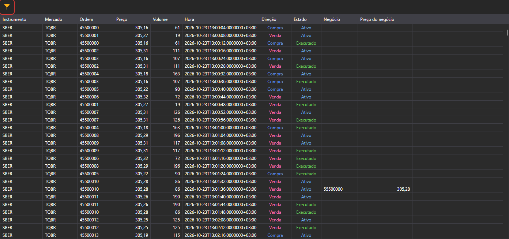

# Registo de ordens

O componente **Registo de ordens** é uma tabela com ordens que apresenta informações completas sobre todas as ordens dos instrumentos selecionados.

O **Registo de ordens** tem um filtro para selecionar os instrumentos necessários.

## Conteúdo recomendado

[Armazenamento de dados de mercado](../../market_data_storage.md)
