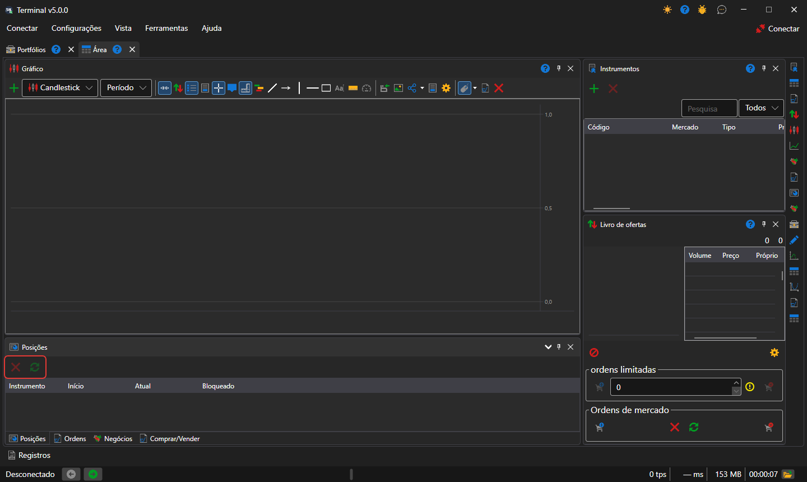

# Posições

O componente **Posições** é uma tabela das posições atuais por instrumentos e carteiras: volume, preço médio, lucros e perdas.

Por cima da tabela estão os botões **Fechar posição** (uma ordem ao mercado que leva a posição selecionada a zero) e **Reverter posição** (uma ordem ao mercado com o dobro do volume da posição, após a qual a posição fica com o mesmo tamanho, mas no sentido oposto). A linha de uma posição pode ser arrastada para um ticket [Compra/Venda](buy_sell.md): o ticket fica com o seu instrumento e a sua carteira.

## Conteúdo recomendado

[Posições](../../../designer/user_interface/components/positions.md)

[Compra/Venda](buy_sell.md)
