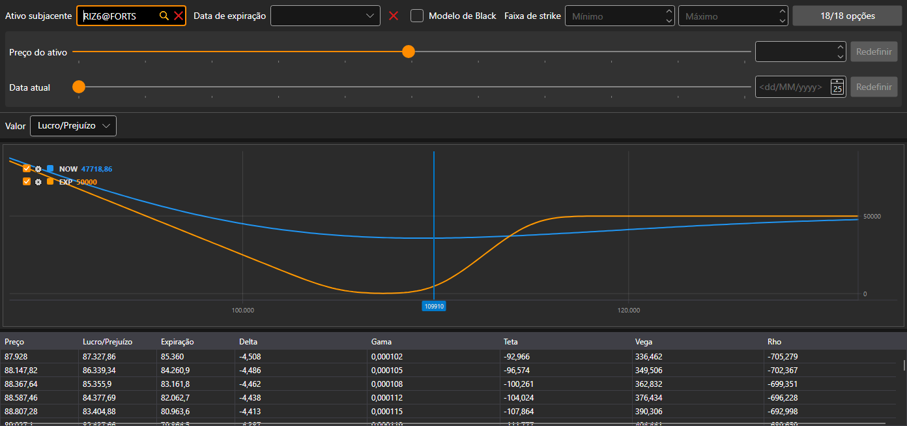

# Posições (opções)

**Posições (opções)** é uma apresentação gráfica da posição por opções: como o seu indicador depende do preço do ativo subjacente.

As opções escolhem-se com o mesmo filtro que no [painel de opções](option_desk.md): ativo subjacente, data de expiração, faixa de strikes e as próprias opções. O cálculo «e se» por baixo do filtro mostra a posição com outro preço do ativo subjacente e noutra data.

Na lista **Valor** escolhe-se o que representar: **Lucro/Prejuízo**, **Delta**, **Gama**, **Teta**, **Vega** ou **Rho**. Por baixo do gráfico há uma tabela de valores segundo os preços do ativo subjacente: **Preço**, Lucro/Prejuízo atual, Lucro/Prejuízo na **Expiração** e as gregas.

## Conteúdo recomendado

[Painel de opções](option_desk.md)

