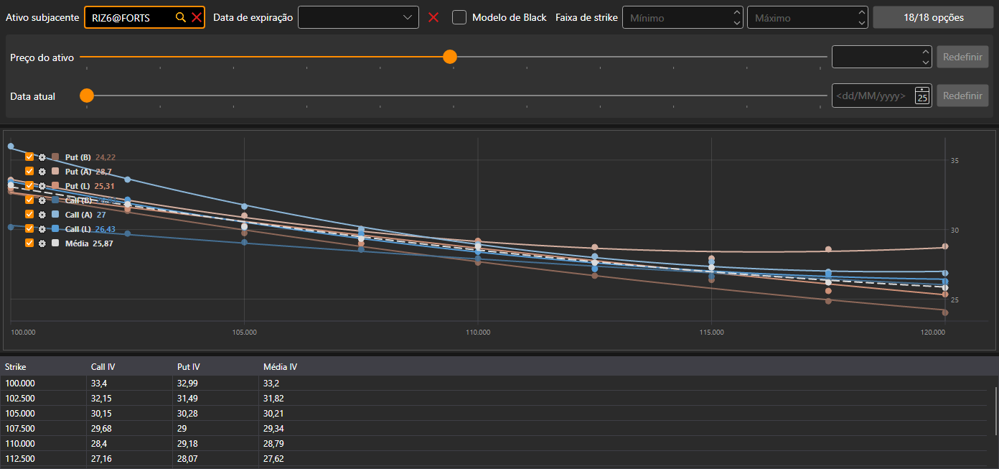

# Sorriso de volatilidade

O componente **Sorriso de volatilidade** é uma representação gráfica do nível de volatilidade esperado para opções com o mesmo ativo subjacente e diferentes strikes.

As opções escolhem-se com o mesmo filtro que no [painel de opções](option_desk.md): ativo subjacente, data de expiração, faixa de strikes e as próprias opções.

No gráfico há sete curvas: a volatilidade implícita das calls e das puts segundo o melhor preço de compra, segundo o melhor preço de venda e segundo o preço do último negócio e, a tracejado, a **Média** da volatilidade da call e da put em cada strike. Por baixo do gráfico há uma tabela: **Strike**, a volatilidade da **Call** e da **Put** (segundo o preço do último negócio ou, se não tiver havido negócios, segundo o melhor preço de compra ou de venda) e a sua **Média**.

## Conteúdo recomendado

[Painel de opções](option_desk.md)

[Posições (opções)](positions_options.md)
