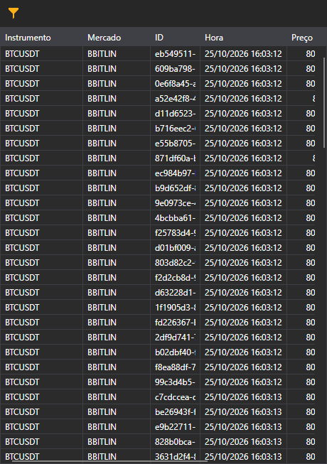

# Fluxo de negócios

O fluxo de negócios do Terminal mostra os negócios de mercado dos instrumentos selecionados. O guia compartilhado de negócios tick explica o filtro de instrumentos deste componente.

Consulte 

[Negócios tick](../../../designer/user_interface/components/tick_trades.md)
