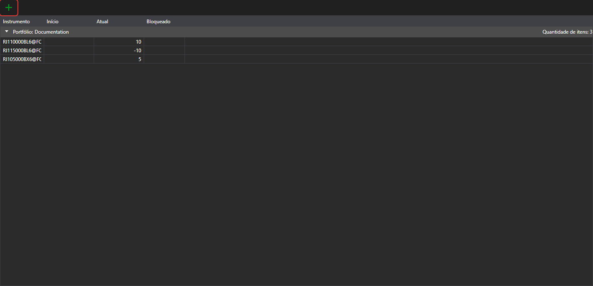

# Portefólios

O painel **Portfólios** mostra os dados das carteiras e as respetivas posições. Abre-se com a opção **Vista → Portfólios** do [menu principal](ribbon.md).

O botão  cria uma posição, e o seu menu pendente, uma carteira ou uma posição. Um duplo clique numa linha abre a posição para edição.

No menu que se abre com um clique direito numa linha, além das opções comuns das [tabelas](tables.md), existem:

- **Editar**: abrir a posição para edição;
- **Fechar posição**: registar uma ordem ao mercado que fecha a posição;
- **Reverter posição**: registar uma ordem ao mercado com o dobro do volume da posição, para que a posição mude de sentido;
- **Retirar**: retirar fundos do mercado; na janela indicam-se o volume e os dados da retirada. A opção está disponível para uma posição positiva num ativo, se a ligação da carteira suportar a retirada de fundos;
- **Ocultar saldos zero**: não mostrar as posições com saldo zero.

Mais informações sobre carteiras, posições e a sua edição no guia comum: [Portefólios](../../designer/user_interface/portfolios.md).
