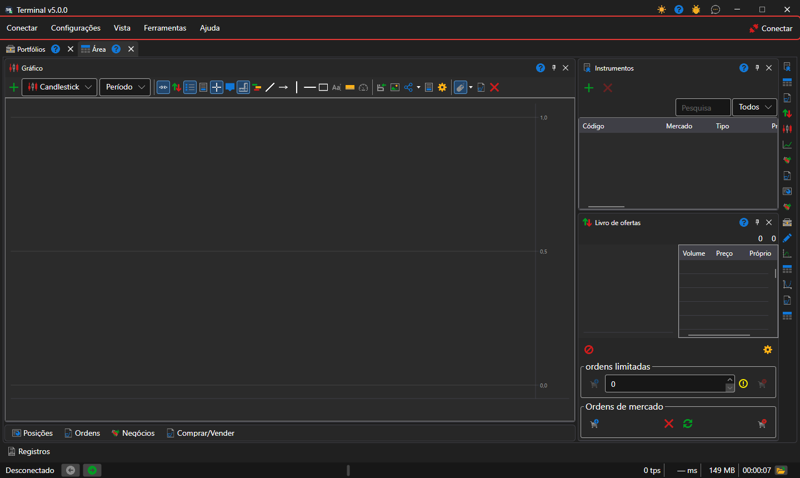

# Menu principal

Por baixo do título da janela do [Terminal](../../terminal.md) está a barra de menus: **Conectar**, **Configurações**, **Vista**, **Ferramentas** e **Ajuda**. No fim da barra está o botão **Conectar**: liga o Terminal a todas as [ligações configuradas](../connection_settings.md) e, enquanto a ligação está estabelecida, chama-se **Desconectar**. Enquanto o Terminal está ligado, as definições das ligações e do emulador não estão disponíveis.

No título da janela, junto aos botões de minimizar e fechar, estão os botões de mudança de tema, de ajuda, **Relatar um problema** e **Fale conosco**.

## Opções do menu

- **Conectar**: ligação e desligamento, [definições das ligações](../connection_settings.md) e definições do emulador, que executa as ordens com dados de mercado reais sem as enviar para o mercado.
- **Configurações**: [definições gerais](../settings/common_settings.md) do programa; **Salvar layout** e **Redefinir layout**, que devolve os painéis às suas posições originais; [reposição das definições](../settings/reset_settings.md); as janelas **Instrumentos e conexões** e **Portfólios e Conexões**, nas quais se atribui a um instrumento ou a uma carteira a ligação através da qual é negociado.
- **Vista**: nova [área de trabalho](workspace.md) (**Área**) e mudança de nome da atual (**Renomear**); painéis de toda a janela: [Registos](logs.md), [Portefólios](portfolios.md), [Editor de mercados](board_editor.md), **Dados de mercado**, [Notícias](components/news.md), [Riscos](risk_management.md); mudança de tema.
- **Ferramentas**: **Criar novo instrumento**, **Novo instrumento de índice** a partir de vários instrumentos e **Instrumento contínuo** a partir de futuros de diferentes vencimentos; o instrumento criado aparece de imediato em [Instrumentos](components/instruments.md) da área aberta.
- **Ajuda**: **Documentação**, **Relatório de erros**, contacto com a equipa da StockSharp e a janela **Sobre o programa**.

## Teclas de atalho

| Teclas | Ação |
|---|---|
| **F5** | ligar ou desligar |
| **Ctrl+,** | definições das ligações |
| **Ctrl+S** | guardar a disposição |
| **Ctrl+T** | mudar o tema |
| **F1** | abrir a ajuda |
| **Alt+C**, **Alt+S**, **Alt+V**, **Alt+T**, **Alt+H** | abrir os menus **Conectar**, **Configurações**, **Vista**, **Ferramentas**, **Ajuda** |
| **F9** | comprar ao mercado no ticket ativo [Comprar/Vender](components/buy_sell.md) |
| **F10** | vender ao mercado no ticket ativo |
| **Esc** | cancelar todas as ordens do ticket ativo |

O ticket ativo é o ticket do painel **Comprar/Vender** da área de trabalho aberta nesse momento. As teclas **F9**, **F10** e **Esc** não funcionam enquanto o cursor estiver num campo de entrada.

> [!WARNING]
> **F9** e **F10** enviam para o mercado ordens de mercado reais sem confirmação.

## Conteúdo recomendado

[Área de trabalho](workspace.md)

[Componentes](components.md)
