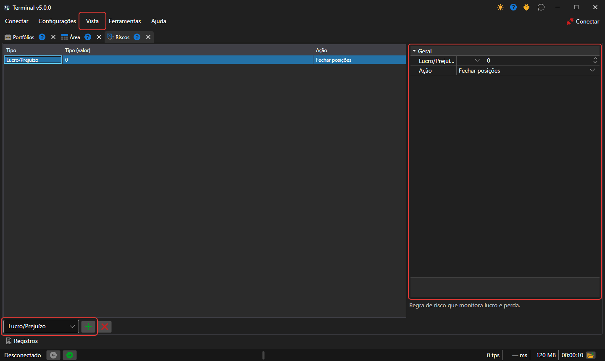

# Gestão de risco

No painel **Risco**, pode definir as definições de controlo de risco. O painel abre-se com a opção **Vista → Riscos** do [menu principal](ribbon.md).

Para adicionar uma **Regra de risco**, é preciso selecionar o seu tipo na lista por baixo da tabela e premir o botão **Adicionar regra**. A regra aparece na tabela e, à direita, as suas definições: a condição de acionamento da **Regra de risco** e a ação (Fechar posições, Parar negociação, Cancelar ordens) que será executada quando a condição se verificar. Por baixo das definições é apresentada a descrição da regra selecionada. O botão **Excluir regra** elimina as regras selecionadas.

As regras são verificadas pela ligação do Terminal, sobre as ordens, os negócios e os dados de carteira que passam por ela. O conjunto de regras é guardado entre arranques do programa.

A lista de regras de risco e a respetiva descrição está disponível na secção [Gestão de risco](../../designer/user_interface/risk_management.md).
