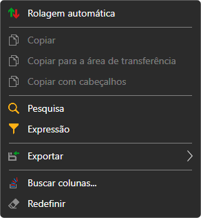
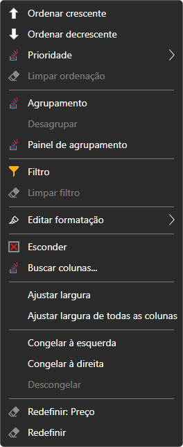

# Trabalho com tabelas

As tabelas de todos os painéis do [Terminal](../../terminal.md) (instrumentos, ordens, negócios, posições, carteiras, Level 1, registo de ordens, notícias) funcionam da mesma forma.

## Menu da tabela

Um clique direito nas linhas da tabela abre o menu:

- **Rolagem automática**: a tabela desloca-se sozinha até às linhas novas;
- **Copiar**, **Copiar para a área de transferência**: copiam as linhas selecionadas para a área de transferência: as colunas visíveis pela ordem em que são mostradas, separadas por tabulações; cada linha da tabela é uma linha de texto. **Copiar com cabeçalhos** acrescenta como primeira linha os nomes das colunas. O mesmo que **Copiar** faz **Ctrl+C**;
- **Pesquisa** (**Ctrl+F**): pesquisa de texto na tabela. É possível escolher em que colunas pesquisar; os botões **Anterior** e **Próximo** passam de uma célula encontrada para outra, e **Limpar** repõe a pesquisa;
- **Expressão**: filtro de linhas com uma condição sobre os valores das colunas, sob a forma de fórmula, por exemplo, `=[Price] > 100`. O campo sugere os nomes das colunas e as funções (`CONTAINS`, `STARTSWITH`, `ENDSWITH`, `TODAY`, `NOW` e outras), mostra de imediato um erro na fórmula, e **Pré-visualização** mostra o que a fórmula dá para a linha selecionada. **Aplicar** ativa o filtro e **Limpar filtro** remove-o;
- **Exportar**: a tabela para a área de transferência (como texto em formato CSV ou como imagem), para um ficheiro CSV, Excel ou PNG. **Compartilhar link da imagem** publica a imagem da tabela no site da StockSharp e copia a ligação para ela; para isso é preciso iniciar sessão no site. **Imprimir** abre a tabela no navegador, a partir do qual pode ser impressa;
- **Buscar colunas...**: janela na qual as colunas são mostradas e ocultadas;
- **Redefinir**: devolver a tabela ao seu aspeto original.

## Menu da coluna

Um clique direito no cabeçalho de uma coluna abre o menu dessa coluna:

- **Ordenar crescente**, **Ordenar decrescente**, **Limpar ordenação**. Um clique no cabeçalho também ordena a tabela por essa coluna. **Prioridade** acrescenta a ordenação pela coluna à já definida, para ordenar por várias colunas ao mesmo tempo;
- **Agrupamento**: agrupar as linhas pelos valores da coluna; **Desagrupar**. **Painel de agrupamento** mostra os níveis de agrupamento: uma coluna pode ser adicionada a partir da lista ou arrastada para o painel pelo cabeçalho, os níveis podem ser reordenados e cada nível tem a sua própria direção de ordenação;
- **Filtro**: filtro de linhas pelos valores desta coluna; **Limpar filtro**;
- **Editar formatação**: regras com as quais as células da coluna são destacadas a cores: **Adicionar regra**; uma regra pode ser editada, desativada ou eliminada;
- **Esconder**: remover a coluna; **Buscar colunas...**: voltar a mostrá-la;
- **Ajustar largura** da coluna e **Ajustar largura de todas as colunas**: largura segundo o conteúdo;
- **Congelar à esquerda**, **Congelar à direita**, **Descongelar**: uma coluna congelada fica no lugar ao deslocar a tabela na horizontal;
- **Redefinir** a coluna ou toda a tabela.

O aspeto da tabela (que colunas são mostradas, a sua ordem e a sua largura) é guardado juntamente com a disposição da janela.

## Ver também

[Área de trabalho](workspace.md)

[Componentes](components.md)
