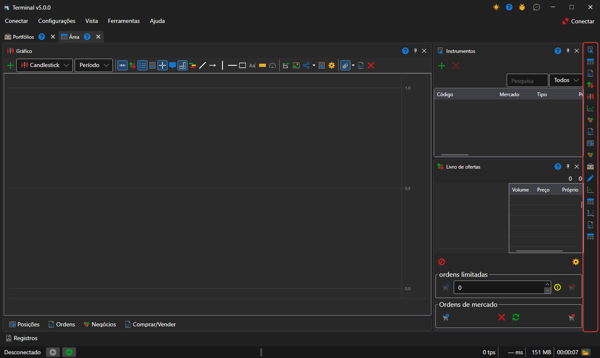
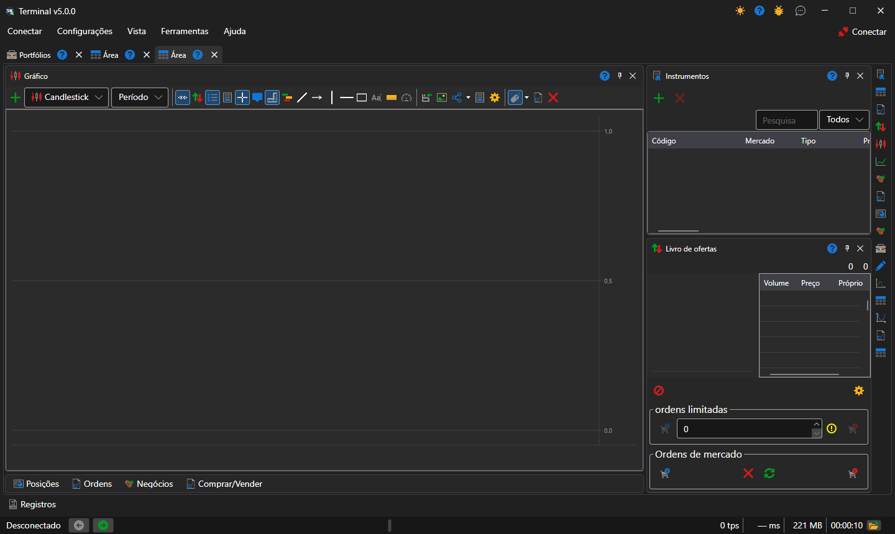

# Área de trabalho

A área de trabalho é um separador da janela do [Terminal](../../terminal.md) com o seu próprio conjunto de painéis: gráficos, tabelas, tickets. Pode haver tantas áreas quantas se quiser, e cada uma funciona por conta própria: o instrumento selecionado numa não altera os painéis de outra.

Uma nova área cria-se com a opção **Vista → Área** do [menu principal](ribbon.md), e a atual muda de nome com a opção **Vista → Renomear**.

## Painéis da área

Os painéis adicionam-se com os botões da faixa vertical junto à margem direita da área, um botão por cada [componente](components.md). Cada clique abre mais um painel desse tipo, pelo que numa área pode haver, por exemplo, dois gráficos de instrumentos diferentes. Um painel pode ser arrastado pelo título para outro sítio da área, acoplado à margem de um painel vizinho, agrupado com ele em separadores ou levado para uma janela à parte.

## Disposição de uma nova área

Uma nova área é organizada como é habitual nos terminais de negociação: o gráfico no centro, em toda a altura; à direita, [Instrumentos](components/instruments.md) por cima do [Livro de ofertas](components/order_book.md), e as tabelas **Posições**, **Ordens**, **Meus negócios** e o ticket **Comprar/Vender**, recolhidos numa linha de separadores por baixo do gráfico. Um clique num separador expande as tabelas, e o botão do seu título volta a recolhê-las. O Terminal memoriza se as tabelas estão recolhidas ou não juntamente com a disposição dos painéis.

O Terminal guarda sozinho a disposição dos painéis a cada alteração; **Configurações → Salvar layout** (Ctrl+S) guarda-a de imediato, e **Configurações → Redefinir layout** devolve os painéis às suas posições originais.

## Ver também

[Menu principal](ribbon.md)

[Componentes](components.md)
