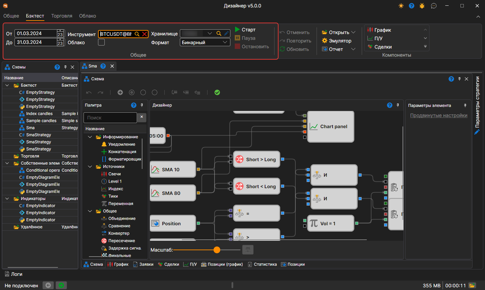
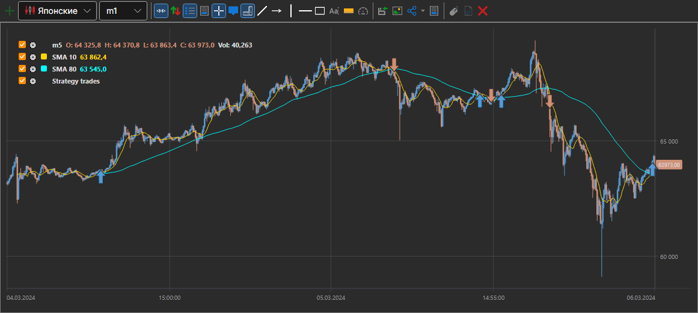
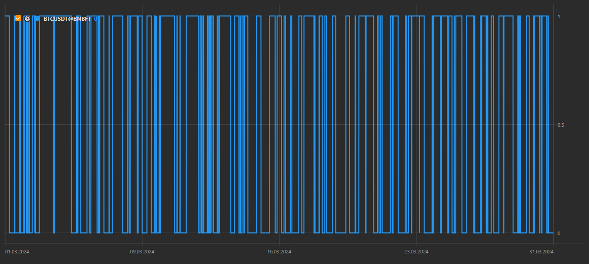
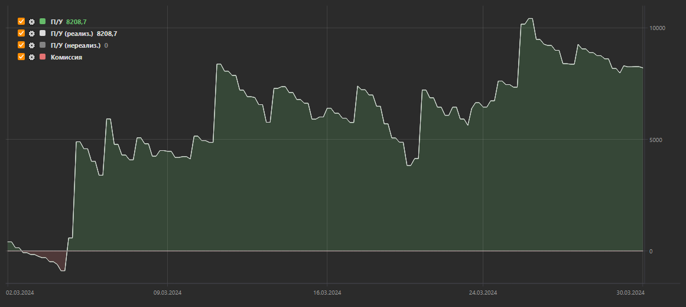

# Пример тестирования на истории

В качестве примера будет рассмотрена пример\-стратегия SMA.

Для запуска тестирования на истории необходимо выбрать стратегию, схема которой будет тестироваться на истории. Стратегия выбирается на панели [Схемы](../user_interface/schemas.md) в папке стратегии, двойным нажатием на интересующей стратегии.

Перед тестированием необходимо загрузить маркет\-данные (инструменты, свечи, тиковые сделки и\/или стаканы). Как это сделать написано в пункте [Хранилище маркет\-данных](../market_data_storage.md).

При переходе на вкладку со стратегией в ленте автоматически откроется вкладка **Бэктест**. На ней необходимо установить период тестирования (**От** и **До**), в поле **Инструмент** выбрать инструмент, а в полях **Хранилище** и **Формат** — хранилище маркет\-данных ([Хранилище маркет\-данных](../market_data_storage.md)) и формат, в котором оно записано.

В примере со стратегией SMA используются следующие параметры:

1. Инструмент BTCUSDT@BNBFT
2. Период с 01.03.2024 по 31.03.2024
3. Хранилище, в которое загружены свечи этого инструмента за этот период
4. Формат хранилища **Бинарный**

Сама стратегия строит по пятиминутным свечам две скользящие средние — **SMA 10** и **SMA 80** — и торгует объёмом, который задаёт кубик **Vol = 1** на схеме.

После установки всех необходимых параметров, запускаем тестирование стратегии, нажав кнопку .

Во время или после тестирования можно рассмотреть графики и таблицы с информацией о тестировании.

На графике видно, что сделки проходят на пересечении скользящих средних, как и задумано стратегией.

На графике **Позиции (график)** видно, что позиция стратегии переходит между 0 и 1: стратегия покупает, когда короткая средняя пересекает длинную снизу вверх, и закрывает позицию при обратном пересечении.

График **П\/У** показывает, как менялись прибыль и убыток стратегии за время теста, а также комиссию.

## См. также

[Live торговля](../live_execution/getting_started.md)
