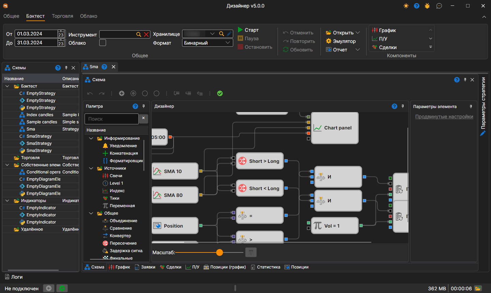
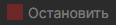
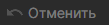
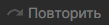
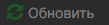

# Интерфейс

Для запуска тестирования на истории необходимо выбрать стратегию, схема которой будет тестироваться на истории. Стратегия выбирается на панели [Схемы](../user_interface/schemas.md) в папке стратегии, двойным нажатием на интересующей стратегии. При выборе стратегии в рабочей области появится новая вкладка со стратегией, при переходе на которую в ленте автоматически откроется вкладка **Бэктест**.

В группе **Общее** вкладки **Бэктест** задаются период тестирования (**От** и **До**), **Инструмент**, хранилище маркет\-данных (**Хранилище**) и формат, в котором оно записано (**Формат**). Флажок **Облако** запускает тестирование в облаке StockSharp, а не на этом компьютере.

Запускается стратегия на тестирование нажатием кнопки **Старт** . После запуска стратегии на тестирование становятся активными кнопка **Пауза** , приостанавливающая тестирование, и кнопка **Остановить** , полностью останавливающая тестирование. При редактировании стратегии полезными будут кнопки **Отменить** (Ctrl+Z) , отменяющая последнее действие, **Повторить** (Ctrl+Y) , возвращающая отменённое, и **Обновить** (Ctrl+R) , полностью обновляющая схему.

Остальные кнопки вкладки:

- **Открыть** — открыть эту же стратегию для [оптимизации](../optimization/brute_force.md) или для [торговли](../live_execution/getting_started.md);
- **Эмулятор** — [настройки эмуляции](../user_interface/components/backtesting_settings.md);
- **Отчет** — отчёт по прошедшему тестированию в формате Excel, JSON, XML или CSV;
- группа **Компоненты** — компоненты, которые можно добавить на вкладку стратегии: график, П/У, сделки и другие.

[Отладчик](debugging.md) — точки останова и пошаговое выполнение — находится на панели **Схема**.

Вкладка выбранной стратегии по умолчанию содержит следующие панели:

- Панель **Схема**, в которой проходит основной процесс работы по дизайну стратегии и составных элементов, путём комбинирования кубиков и соединительных линий. Панель **Схема** подробно описана в пункте [Дизайнер стратегии](../strategies/using_visual_designer/diagram_panel.md).
- Панели информационных компонентов — **График**, **Заявки**, **Сделки**, **П/У**, **Позиции (график)**, **Статистика**, **Позиции** — вкладками под схемой.
- Панель **Параметры стратегии**, по умолчанию свёрнутая у правого края вкладки стратегии: параметры схемы, которые можно менять перед запуском.

## См. также

[Свойства тестирования](../user_interface/components/backtesting_settings.md)
