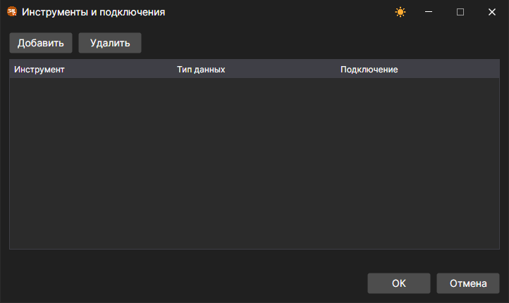

# Сопоставление инструментов и подключений

Один и тот же инструмент в разных торговых системах может называться по\-разному, а данные и заявки по нему могут идти через разные подключения. Для этого в [Designer](../../designer.md) есть три окна.

## Сопоставление кодов

Кнопка **Сопоставление кодов** на панели маркет\-данных открывает окно **Инструменты <\-> Инструменты в адаптерах**. В списке над таблицей выбирается подключение, кнопка  добавляет строчку, а кнопка удаления убирает выделенную. В столбцах **Код инструмента** и **Код площадки** указывается инструмент, как он назван в **Дизайнере**, а в столбцах **Код в адаптере** и **Код площадки в адаптере** \- как его называет выбранное подключение.

## Инструменты и подключения

Пункт **Инструменты и подключения** выпадающего списка кнопки **Подключиться** вкладки **Общее** открывает окно, в котором для инструмента и типа данных выбирается подключение, через которое эти данные получать. Кнопка **Добавить** добавляет строчку, в которой заполняются столбцы **Инструмент**, **Тип данных** и **Подключение**; кнопка **Удалить** убирает выделенную строчку.

## Портфели и подключения

Пункт **Портфели и подключения** того же списка открывает такое же окно для портфелей: в столбце **Портфель** указывается портфель, а в столбце **Подключение** \- подключение, через которое по нему отправляются заявки.

В [Terminal](../../terminal.md) оба окна открываются из меню **Настройки** [главного меню](../../terminal/user_interface/ribbon.md).
