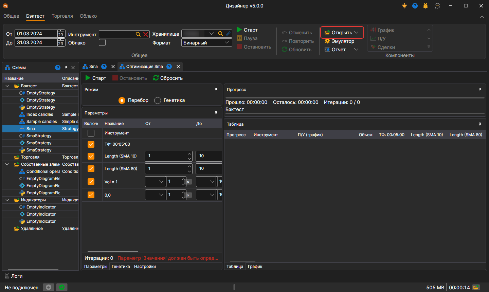
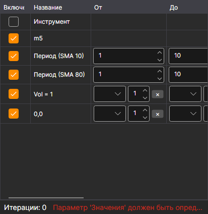
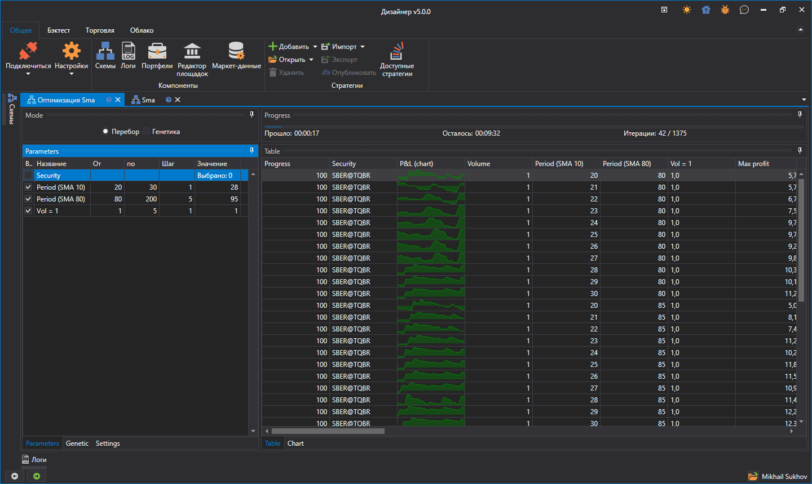
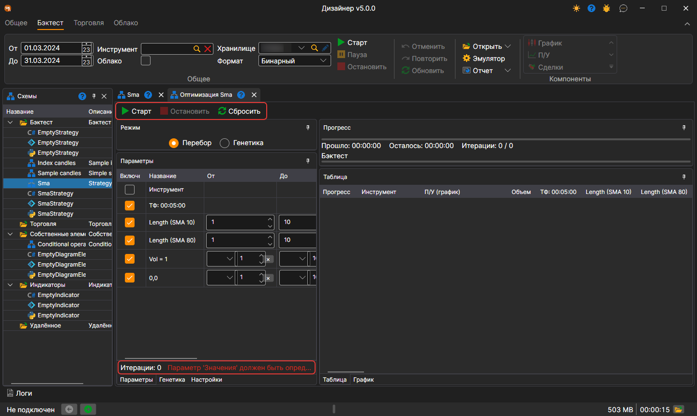

# Перебор (брут-форс)

Чтобы перейти в режим оптимизации стратегии необходимо на вкладке **Бэктест** открыть выпадающий список **Открыть** и выбрать **Оптимизация**. Пример оптимизации будет рассмотрен на примере стратегии SMA, созданной [из кубиков](../strategies/using_visual_designer/first_strategy.md).

В рабочей области откроется вкладка с названием Оптимизация + «Имя стратегии». Вкладка **Оптимизация** разделена на две зоны: слева — что и как оптимизировать, справа — результат оптимизации:

- Слева вверху — **Режим**: **Перебор** или **Генетика**. Под ним закладки: **Параметры** — параметры стратегии, по которым [происходит перебор](optimization_parameters.md); **Генетика** — настройки [генетики](genetic.md); **Настройки** — настройки эмуляции и самого оптимизатора, например сколько прогонов выполнять одновременно (**Параллельно**) и сколько итераций допустимо (**Итерации**).
- Справа — **Прогресс**: сколько времени прошло, сколько примерно осталось и сколько итераций выполнено из запланированных. Под ним закладка **Таблица**, каждая строчка которой — результат тестирования стратегии с уникальными параметрами, и закладка **График** для отображения результатов в виде [3D графика](3d_chart.md).

Задав параметры для перебора, итогово получается больше 1000 итераций. После запуска оптимизатора вверху над результатами будет показан прогресс с данными о том, сколько планируется итераций, сколько их уже выполнено и сколько примерно времени требуется до полного окончания:

## Таблица параметров и кнопки панели

В таблице параметров у каждой строки видно, сколько значений она даёт при заданных **От**, **До** и **Шаге** (колонка **Количество**), и что в строке не так (колонка **Ошибка**) — например, шаг, при котором перебор не дойдёт до верхней границы. Под таблицей — сколько прогонов даст перебор всех параметров вместе и первая ошибка, если она есть.

Кнопки **Старт**, **Остановить** и **Сбросить** стоят прямо на панели оптимизатора, а под ними — полоса хода текущего прогона. В таблице результатов есть колонка **Инструмент**, по которому прошёл прогон.

## См. также

[Пример тестирования на истории](../backtesting/getting_started.md)
