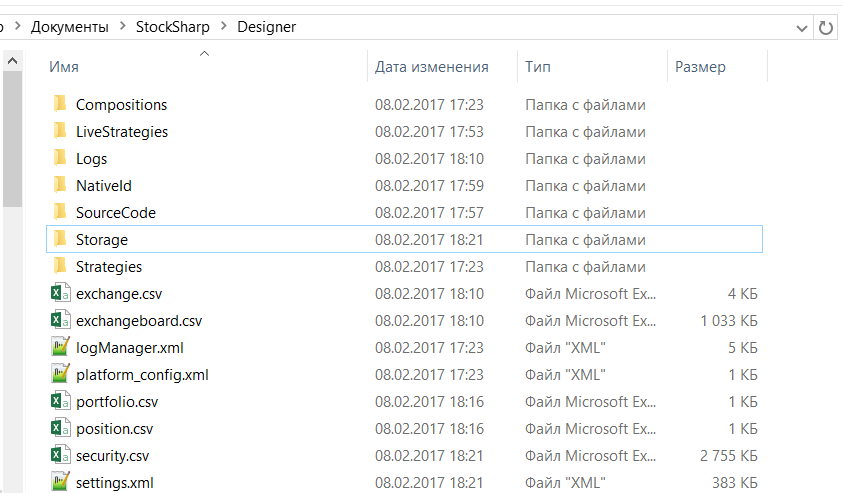

# Редактирование данных вручную

Для работы [Designer](../../designer.md) важными являются следующие директории:

1. Директория куда был установлен [Designer](../../designer.md), из этой папки можно запустить [Designer](../../designer.md) запустив файл **Designer.exe**. Или обновить [Designer](../../designer.md), запустив файл **Designer.Update.exe**. Удаление этой директории приведет к удалению [Designer](../../designer.md), но настройки [Designer](../../designer.md) удалены не будут.

2. Директория настроек **Designer** расположена в документах пользователя в папках …\\StockSharp\\Designer\\ (например, c:\\Users\\ПОЛЬЗОВАТЕЛЬ\\Documents\\StockSharp\\Designer\\). Удаление этой директории приведет к тому, что все настройки [Designer](../../designer.md) сбросятся до настроек по умолчанию, **все созданные стратегии и скачанные инструменты и другая информация, хранящаяся в директории настроек, будет УНИЧТОЖЕНА**.

В этой директории расположены следующие папки и файлы:

- Папки **Backtest**, **Live**, **Remote**, **Optimization**, **Custom** и **Indicator** соответствуют папкам **Бэктест**, **Торговля**, **Удалённое**, оптимизациям, **Собственные элементы** и **Индикаторы** панели [Схемы](../user_interface/schemas.md). Каждая стратегия, кубик или индикатор хранится в своём файле JSON с идентификатором вместо имени. Удаление файла приведет к удалению соответствующей стратегии или кубика из панели [Схемы](../user_interface/schemas.md). Редактировать эти файлы вручную не следует, это может привести к неисправности соответствующей стратегии или кубика. Файл, который не удалось прочитать, при запуске пропускается: остальные стратегии загружаются, а причина записывается в лог. Если вручную добавить файл стратегии в одну из этих папок и перезапустить [Designer](../../designer.md), стратегия появится в соответствующей папке панели [Схемы](../user_interface/schemas.md).
- Папка **Logs**, в ней содержатся все аварийные логи [Designer](../../designer.md), что упрощает диагностику неисправностей работы [Designer](../../designer.md).
- Папка **Storage** \- маркет\-данные, скачанные [Designer](../../designer.md) в соответствующее [Хранилище маркет\-данных](../market_data_storage.md). Папка создается при создании [Хранилище маркет\-данных](../market_data_storage.md). По умолчанию путь указан в эту папку. Удаление этой папки приведет к удалению всех скачанных маркет\-данных соответствующего хранилища. Если хранилище содержит файлы CSV формата, то они могут быть отредактированы стандартным блокнотом или MS Excel. Файлы BIN вручную редактировать невозможно.
- Файлы **exchange.csv и exchangeboard.csv** содержат список **Бирж**, список кодов инструментов и режимов торгов. Эти файлы могут быть отредактированы стандартным блокнотом или MS Excel.
- Файл **security.csv** содержит все полученные и созданные инструменты по всем источникам. Удаление этого файла приведет к удалению всех инструментов в [Designer](../../designer.md). О добавлении новых инструментов описано в пунктах [Скачивание инструментов](../market_data_storage/download_instruments.md), [Создание инструмента](../market_data_storage/create_instrument.md). Этот файл может быть отредактирован стандартным блокнотом или MS Excel.
- Файлы **portfolio.csv и position.csv** содержат все полученные и созданные портфели и текущую позицию по ним. Удаление этих файлов приведёт к удалению соответствующих данных в [Designer](../../designer.md). Если информацию о портфелях [Designer](../../designer.md) получает при каждом подключении, то информация о позициях может быть утеряна безвозвратно. Эти файлы могут быть отредактированы стандартным блокнотом или MS Excel.
- Файл **settings.json** содержит текущие настройки. Этот файл [Designer](../../designer.md) создаёт при изменении настроек или при закрытии программы. Удаление этого файла приведет к сбросу текущих настроек до настроек по умолчанию. Редактировать этот файл вручную не следует, это может привести к неисправности [Designer](../../designer.md).

При необходимости редактирования отдельных файлов или сброса настроек [Designer](../../designer.md) полезным будет делать резервные копии как отдельных файлов так и всей директории.

## См. также

[Обновление на новую версию](../update_to_the_new_version.md)
