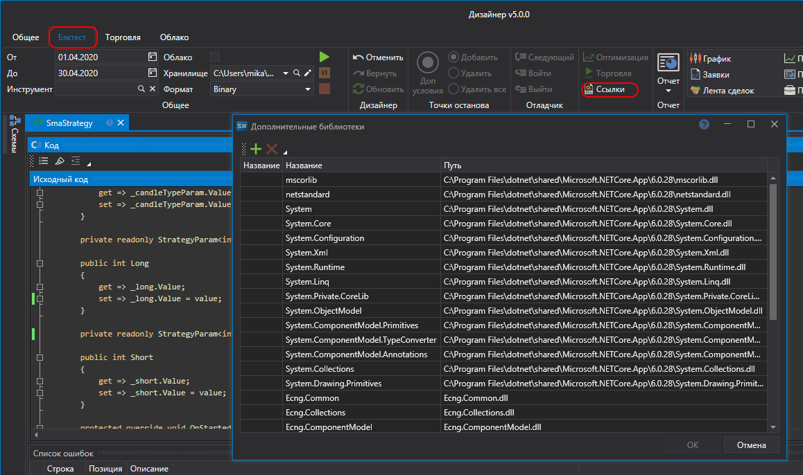

# Внешние DLL

При создании контента из **Исходного кода** наряду с библиотеками [API](../../../../api.md) можно использовать и другие библиотеки C\#, в том числе и собственные. Эти библиотеки должны быть совместимы с .NET 10. Для добавления ссылки на библиотеку, необходимо нажать на кнопку **Ссылки** на панели кода. После этого откроется окно **Дополнительные библиотеки**, в котором можно добавить или удалить необходимые библиотеки:

- **Сборка** \- добавить ссылку на файл библиотеки;
- **Проект** \- добавить ссылку на собственный код или индикатор, созданный в Designer;
- **Удалить** \- удалить выделенную ссылку.

Таблица ссылок показывает название, путь и статус каждой ссылки, а строка **Поиск** над ней находит ссылку в длинном списке. Если ссылку добавить нельзя, причина пишется красным под таблицей.

