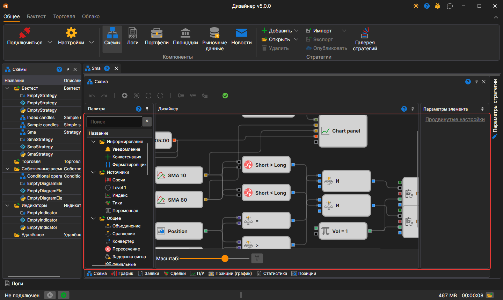
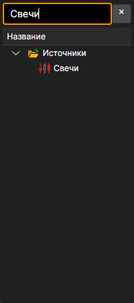
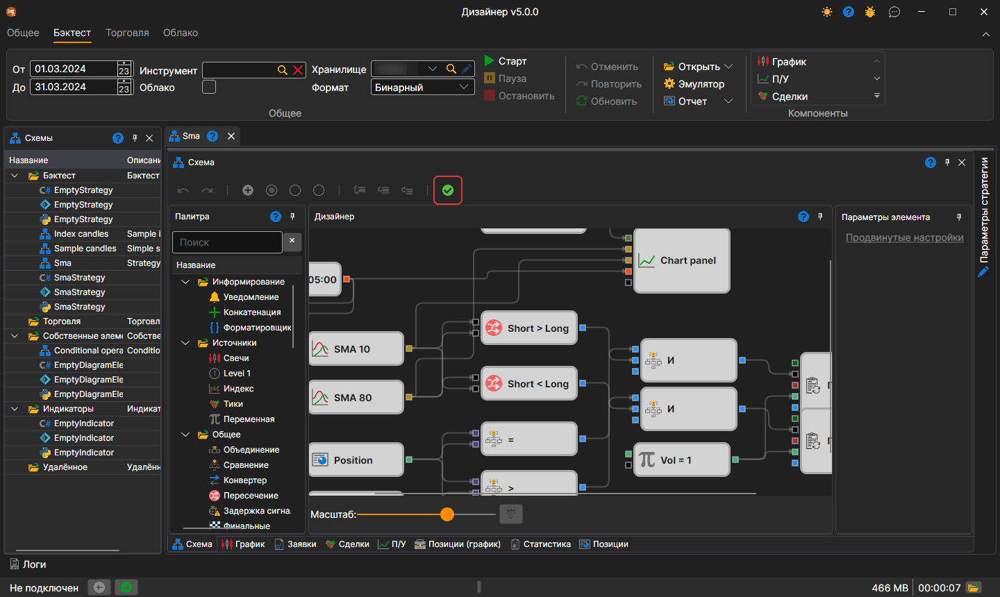
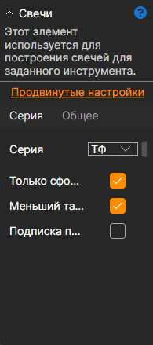
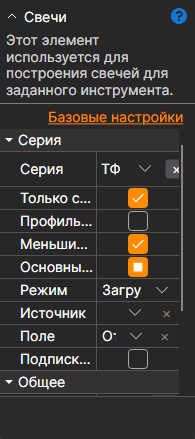

# Дизайнер стратегии

Основной процесс работы по дизайну стратегии и составных элементов проходит в панели **Схема**, путём комбинирования кубиков и соединительных линий. Панель Схема состоит из панелей: **Палитра**, **Дизайнер**, **Параметры элемента**.

## Панель Палитра

На панели **Палитра** расположены кубики, из которых создаются стратегии. Все элементы в палитре разделены на категории, которые описаны в разделе [Описание кубиков](elements.md). Для добавления кубика на панель **Дизайнер** достаточно нажать левой кнопкой мыши на требуемый кубик и, не отпуская кнопки, перенести его на панель **Дизайнер**. Двойной щелчок по кубику кладёт его в центр панели **Дизайнер**. После чего элемент будет автоматически выделен и его параметры будут показаны в окне для редактирования свойств кубика.

Строка поиска над палитрой находит кубик по названию, по описанию и по названию категории. Клавиша **Enter** кладёт на панель **Дизайнер** выбранный кубик, а если ничего не выбрано — первый найденный.

## Панель Дизайнер

На панели **Дизайнер** происходит весь процесс создания стратегии с помощью комбинирования кубиков и соединений (линий). При этом наглядно представляется схема стратегии. Подробно о создании стратегии описано в пункте [Создание алгоритма из кубиков](first_strategy.md).

Выделенные кубики сдвигаются стрелками на клавиатуре: на один шаг, а с нажатой **Shift** — на десять. Пока тянется соединительная линия, подсвечены только те гнёзда, к которым её можно подключить, и конец линии сам притягивается к ближайшему из них.

Масштаб схемы меняется ползунком **Масштаб** под панелью или колесом мыши с нажатой **Ctrl**. Клавиши панели **Дизайнер**:

| Клавиши | Действие |
|---|---|
| **Ctrl+Z**, **Ctrl+Y** | отменить и повторить действие |
| **Ctrl+C**, **Ctrl+X**, **Ctrl+V** | копировать, вырезать и вставить выделенные кубики |
| **Ctrl+A** | выделить все кубики |
| **Delete** | удалить выделенное |
| **Esc** | снять выделение или прервать протягивание линии |
| **Ctrl+«+»**, **Ctrl+«−»** | увеличить и уменьшить масштаб |
| **Ctrl+0** | вернуть исходный масштаб |
| **Ctrl+1** | вписать всю схему в панель |
| **Alt+Z** | вписать схему в панель или вернуть прежний масштаб |

Кнопка с галочкой на панели схемы — подсказка у неё **Проверить схему, сгенерировав и скомпилировав её код** — проверяет схему, не запуская стратегию. Если в схеме ошибка, её текст выводится красным поверх панели **Дизайнер**; там же показываются ошибки отладчика.

## Панель Параметры элемента

На панели **Параметры элемента** отображаются параметры выбранного кубика на панели **Дизайнер**. Выбранный кубик выделяется рамкой.

Панель **Параметры элемента** может быть отображена в двух режимах: *Базовые настройки* и *Продвинутые настройки*

По умолчанию при построении схемы изначально свойства отображаются в режиме *базовых настроек*, для переключения в режим *продвинутых настроек* необходимо нажать на соответствующее название.

В режиме *базовых настроек* отображаются только самые необходимые свойства кубика. Например, для кубика [Свечи](elements/data_sources/candles.md), будет отображен тайм-фрейм, флаг получения только сформированных свечей, флаг возможности построения свечей из меньшего тайм-фрейма, флаг подписки на свечи по сигналу.

В режиме *продвинутых настроек* будут отображены все свойства кубика доступные к изменению и настройке.

Все кубики содержат набор предопределенных свойств, которые становятся видны в режиме *продвинутых настроек*:

- **Название** – название элемента, которое отображается в дизайнере.
- **Уровень логирования** – уровень ведения логов для данного элемента.
- **Параметры** – отображать параметры элемента в элементах более высокого уровня.
- **Сокеты** – отображать сокеты элемента в элементах более высокого уровня.

Подробно о свойствах каждого кубика описано в пункте [Описание кубиков](elements.md).
## См. также

[Описание кубиков](elements.md)
