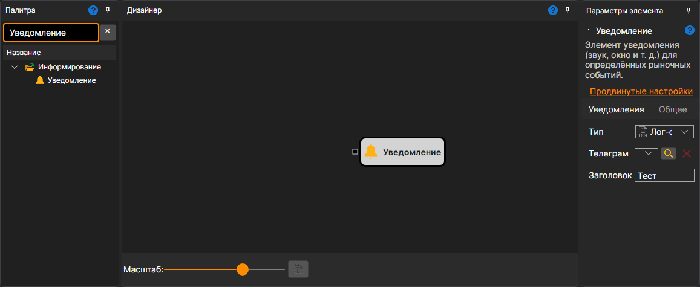

# Уведомление

Кубик отправляет уведомление, когда на его входной сокет поступают данные. Значение приводится к строке через `ToString`. Можно подключить [Переменную](../data_sources/variable.md), чтобы отправлять постоянный текст, подсоединить потоки сделок или свечей, чтобы получить их описание, либо использовать кубики [Формат строки](string_format.md) и [Конкатенация строк](string_concat.md) для подготовки произвольного сообщения.

### Входящие сокеты

Входящие сокеты

- **Сообщение** — данные для отправки. Принимается любое значение и приводится к строке.

### Параметры

Параметры

- **Тип** — как отправить сообщение: звуком, всплывающим окном, в лог-файл или в Telegram. Способы описаны в пункте [Уведомления](../../../../../terminal/notifications.md).
- **Telegram** — канал, используемый для Telegram-уведомлений.
- **Заголовок** — заголовок сообщения.

## См. также

[Формат строки](string_format.md)
[Конкатенация строк](string_concat.md)
[Уведомления](../../../../../terminal/notifications.md)
