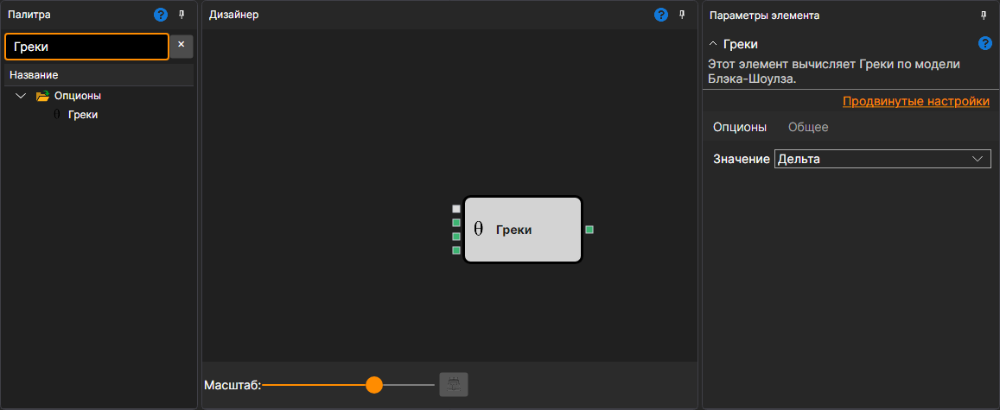

# Греки

Кубик используется для расчета основных "греков": Дельта, Гамма, Вега, Тета, Ро в текущий момент времени.

### Входящие сокеты

Входящие сокеты

- **Модель** – модель расчета (например, Блэк-Шоулз).
- **Цена базового актива** – цена базового актива.
- **Максимальное отклонение** – максимальное отклонение.
- **Премия** – цена опциона. По ней кубик находит подразумеваемую волатильность, когда **Значение** – IV; для остальных значений не нужна.

### Исходящие сокеты

Исходящие сокеты

- **Результат** – результат расчета основных "греков": Дельта, Гамма, Вега, Тета, Ро в текущий момент времени.

### Параметры

Параметры

- **Значение** – может принимать тип "грека" Дельта, Гамма, Вега, Тета, Ро, а также Премия (цена опциона по модели) и IV (подразумеваемая волатильность в процентах по входу **Премия**), и определяет какое значение будет на выходе кубика.

## См. также

[Хеджирование](black_scholes.md)