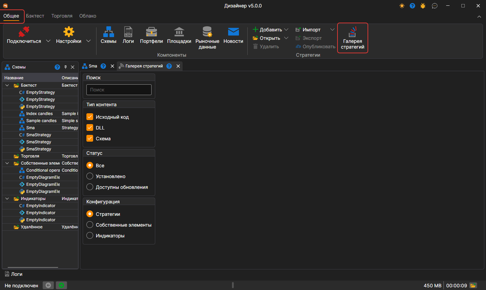
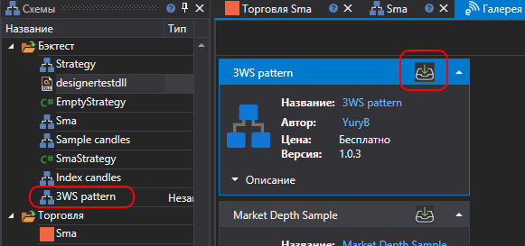

# Галерея стратегий

С помощью **галереи стратегий** предоставляется возможность скачать себе на компьютер уже готовые торговые стратегии. Открыть **Галерею стратегий** можно, нажав на кнопку **Галерея стратегий** вкладки **Общее**.

Карточки стратегий появляются по мере того, как каталог читается с сайта, а пока чтение идёт, в панели видна надпись **Загрузка стратегий из галереи...**. Если каталог прочитать не удалось, панель показывает причину и кнопку **Обновить**, которая повторяет загрузку.

Для скачивания стратегии к себе на компьютер необходимо:

- выбрать интересующую стратегию, и нажать на кнопку Скачать:

  

- стратегия будет добавлена в дерево стратегий в раздел **Бэктест**:

  

## См. также

[Публикация своей стратегии](strategy_gallery/publish_own_strategy.md)
