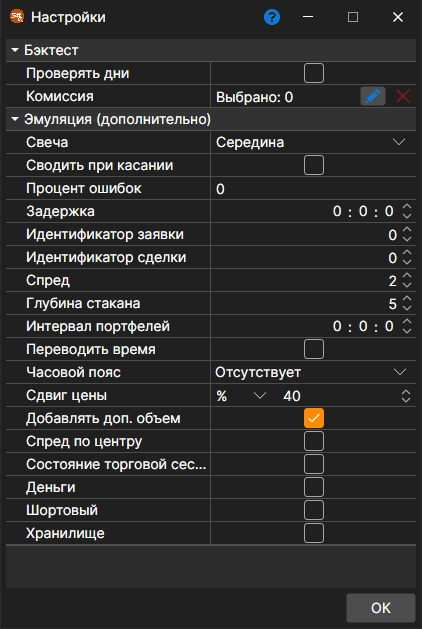

# Свойства тестирования

Настройки эмуляции открываются кнопкой **Эмулятор** на вкладке **Бэктест** ленты, когда открыта стратегия для тестирования на истории или для оптимизации. При выделении свойства внизу окна появляется его подробное описание. Свойства сгруппированы:

**Бэктест**

- **Проверять дни** \- проверять, являются ли загружаемые дни торговыми.
- **[Комиссия](../commissions.md)** \- комиссия (брокерская, биржевая и т.д.).

**Эмуляция (дополнительно)**

- **Свеча** \- по какой цене свечи исполняются заявки, когда тест идёт на свечах: середина, открытие, максимум, минимум или закрытие.
- **Сводить при касании** \- при эмулировании сведения по сделкам, производить сведение заявок, когда цена сделки коснулась цены заявки (равна цене заявки).
- **Процент ошибок** \- процентное значение ошибки регистрации новых заявок. Значение может быть от 0 (не будет ни одной ошибки) до 100.
- **Задержка** \- минимальное значение задержки выставляемых заявок.
- **Идентификатор заявки** \- число, начиная с которого эмулятор будет генерировать идентификаторы для заявок.
- **Идентификатор сделки** \- число, начиная с которого эмулятор будет генерировать идентификаторы для сделок.
- **Спред** \- размер спреда в шагах цены. Используется при определении спреда для генерации стакана из тиковых сделок.
- **Глубина стакана** \- максимальная глубина стакана, который будет генерироваться из тиков.
- **Интервал портфелей** \- интервал перерасчета данных по портфелям. Если интервал равен нулю, то перерасчет не выполняется.
- **Переводить время** \- переводить время для заявок и сделок в биржевое.
- **Часовой пояс** \- часовой пояс биржи.
- **Сдвиг цены** \- сдвиг цены от последней сделки, определяющий границы максимальной и минимальной цен на следующую сессию.
- **Добавлять доп. объем** \- добавлять дополнительный объем в стакан при выставлении заявок с большим объемом.
- **Спред по центру** \- делить спред поровну вокруг цен, по которым неизвестно, какая сторона торговала (например, цен из свечей), чтобы покупка и продажа платили одинаковую половину спреда.
- **Состояние торговой сессии** \- проверять торговое состояние.
- **Деньги** \- проверять денежный баланс.
- **Шортовый** \- можно ли открывать шортовые позиции.
- **Хранилище** \- разрешить сохранять сообщения, которые создаёт эмулятор.

Период тестирования, инструмент, хранилище маркет\-данных и его формат задаются на самой вкладке **Бэктест** ([Интерфейс](../../backtesting/user_interface.md)), а параметры схемы — на панели **Параметры стратегии** у правого края вкладки стратегии.

## См. также

[График](chart.md)
