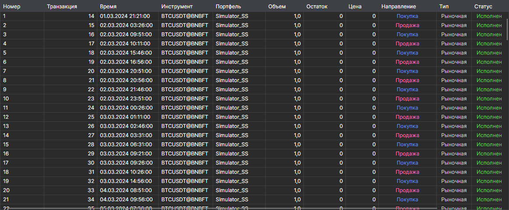

# Заявки

Компонент **Заявки** представляет собой таблицу с заявками, в которой отображается полная информация о всех заявках стратегии. 

Список над таблицей выбирает, какие заявки показывать: **Все**, только активные (**Активен**), исполненные (**Исполнено**) или отклонённые (**Сбой**).

Как копировать строки таблицы, искать и фильтровать их и настраивать колонки, описано в разделе [Работа с таблицами](../../../terminal/user_interface/tables.md).

## См. также

[Сделки](trades.md)
