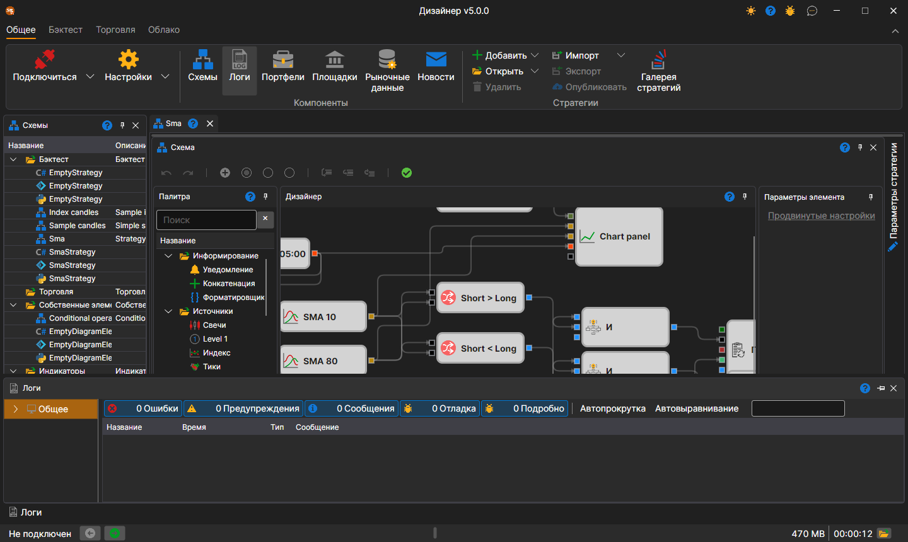

# Рабочая область

**Рабочая область** является оконным интерфейсом с закреплением панелей, наподобие той, что используется в Microsoft Visual Studio. Нажав на заголовке панели левой кнопкой мыши, и удерживая ее, можно закрепить панель в удобном месте. А захватив край панели, можно регулировать высоту или ширину панели:

Внизу окна идёт строка состояния: подключён ли [Designer](../../designer.md) (**Не подключен**, **Подключен** или текст ошибки подключения), новости StockSharp, счётчики предупреждений и ошибок журнала, последнее сообщение журнала — щелчок по нему открывает [Панель Логи](logs.md), — занятая память, время работы и кнопка папки журналов. Подробнее эти части описаны в разделе [Строка состояния](../../terminal/user_interface/status_bar.md) Terminal.

## См. также

[Панель Логи](logs.md)
