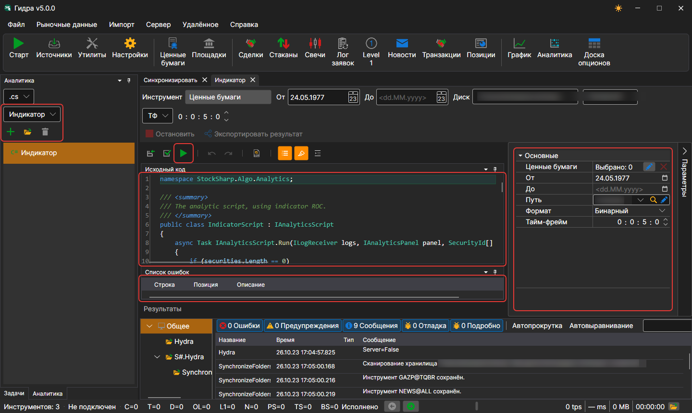
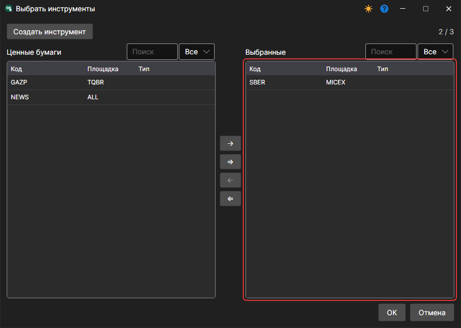

# Запуск скрипта

Чтобы создать новый скрипт для аналитики, откройте на левой панели вкладку **Аналитика**, выберите язык скрипта и шаблон для быстрого старта и нажмите **Добавить**. Скрипт откроется в отдельной вкладке:

На скриншоте представлен основной интерфейс данной функции, состоящий из нескольких ключевых компонентов:

- **Панель «Аналитика»**: слева выбираются язык и шаблон нового скрипта (объём внутри дня, профиль объёма, графики, индикаторы и другие инструменты анализа); под ними — кнопки-значки **Добавить**, **Открыть** и **Удалить** (название кнопки видно во всплывающей подсказке) и список созданных скриптов.
- **Параметры запуска и кнопки**: над кодом задаются инструменты, период, хранилище, формат и тайм-фрейм, а кнопками выполняются **Сохранить исходник**, **Ссылки** (сборки и пакеты, на которые ссылается скрипт), **Скомпилировать и запустить исходник**, **Остановить** и **Экспортировать результат**.
- **Окно кода**: Окно кода отображает исходный код выбранного аналитического скрипта. Пользователи могут напрямую редактировать код для настройки или создания аналитических расчётов и стратегий.
- **Панель параметров**: справа, раскрывается кнопкой **Параметры**; в ней задаются параметры аналитических скриптов, включая выбор инструмента, периода анализа, путь к данным и другие настройки.
- **Список ошибок**: В нижней части интерфейса отображается список ошибок, которые были обнаружены во время компиляции или выполнения аналитического скрипта.

Скрипт аналитики оформлен в виде класса, унаследованного от [IAnalyticsScript](xref:StockSharp.Algo.Analytics.IAnalyticsScript).

При задании параметров:

- **Инструмент** можно задать от одного до нескольких инструментов в зависимости от логики скрипта.

- диапазон дат.
- хранилище, из которого брать данные.
- рабочий тайм-фрейм скрипта, если он его использует.

При нажатии на кнопку  скрипт будет скомпилирован и запущен, а результаты его работы откроются в новой вкладке.
