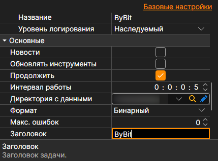

# Общие параметры подключения

Свойства подключения, общие для всех источников.

**Основные**

Свои настройки у каждого источника идут первыми: ключи, адреса, переподключение. За ними следуют общие для всех источников:

- **Новости** \- скачивать новости.
- **Обновлять инструменты** \- обновлять инструменты при подключении.
- **Продолжить** \- продолжать скачивание с последней скачанной даты.
- **Интервал работы** \- интервал работы.
- **Директория с данными** \- директория с данными, куда будут сохраняться конечные файлы в формате StockSharp.
- **Формат** \- формат данных: BIN\/CSV.
- **Макс. ошибок** \- максимальное количество ошибок, после которого задача будет остановлена. По умолчанию равно 0, что означает игнорирование количества ошибок.
- **Заголовок** \- заголовок задачи.
- **Рабочее время** \- расписание работы задачи.
- **Проверка** \- что делать с данными, не прошедшими проверку: ничего, удалять их или останавливать подписку.

**Удалённое**

- **Включено** \- управлять задачей удалённо.
- **Уведомление** \- канал, в который приходят уведомления о задаче.
- **Уровень логирования** \- какие сообщения задачи отправлять в канал.
