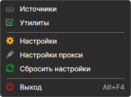
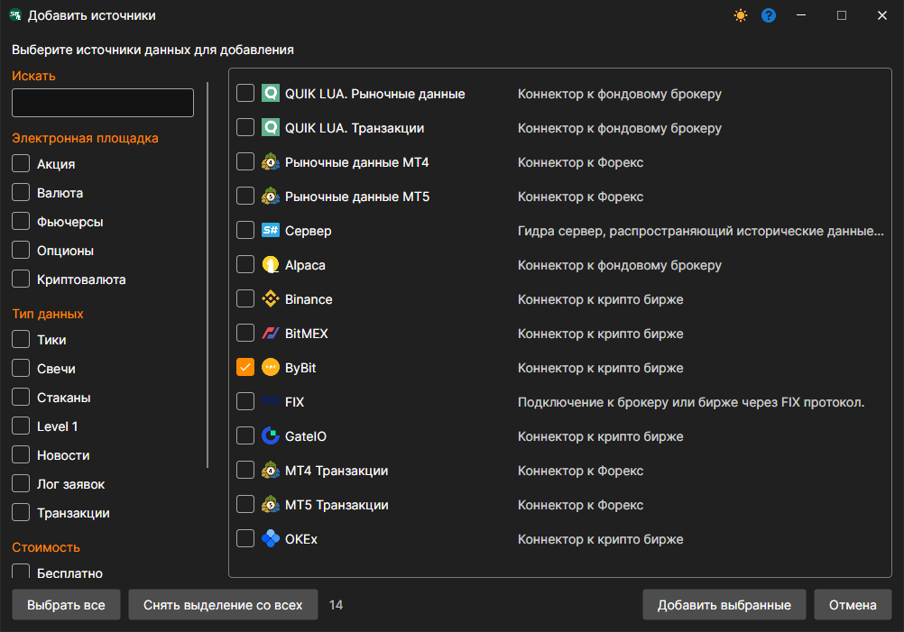
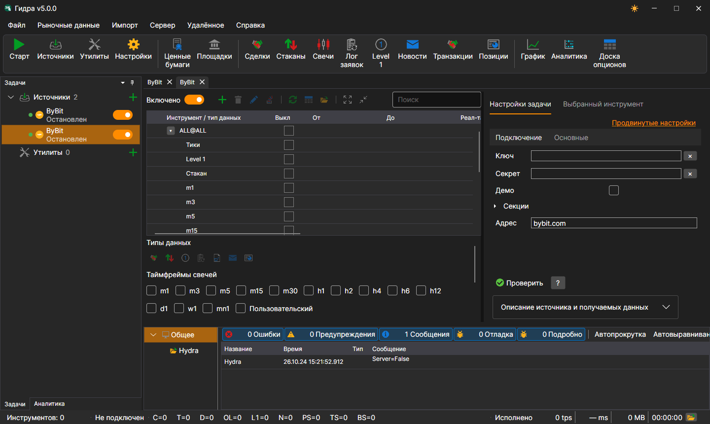
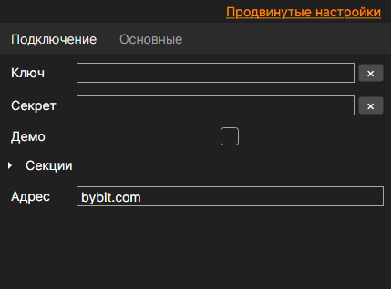

# Выбор источника данных

Чтобы добавить новый источник маркет\-данных, откройте меню **Файл** и выберите пункт **Источники** — или нажмите кнопку **Источники** на панели инструментов.

Откроется список источников. Отметить можно сразу несколько — щелчком по флажку или по названию — и нажать **Добавить выбранные**.

Можно добавить и несколько экземпляров одного источника — например, два **ByBit** с разными ключами или разными папками для скачанных данных. Каждый экземпляр — отдельная задача на панели **Задачи**. Различить их помогает **Заголовок** на вкладке **Основные** в настройках источника.

Чтобы источник после нажатия кнопки **Старт** скачивал данные, его нужно включить. Для этого служит переключатель : он есть у каждого источника на панели **Задачи** и над таблицей инструментов источника (**Включено**). Включить источник можно до или после добавления инструментов.

Ненужный источник удаляется командой **Удалить** в контекстном меню источника на панели **Задачи**.

Настройки источника — на вкладке **Настройки задачи** справа от таблицы инструментов. На вкладке **Подключение** — то, без чего источник не подключится: ключи, адрес и т. п., на вкладке **Основные** — остальное. Ссылка **Продвинутые настройки** показывает все параметры источника, а не только основные.

Общие настройки для всех источников можно посмотреть в пункте [Общие параметры подключения](common_connection_settings.md).

Каждое подключение имеет свои особенности, по ссылке ["Список коннекторов"](../data_sources.md) приведен перечень коннекторов и их настройки.

**Смотреть [видеоинструкцию](../videos/sources_samples.md)**
