# Первый запуск

При первом запуске Гидра предлагает выбрать источники данных. Позже это же окно открывается кнопкой **Источники** на панели инструментов или из меню **Файл**.

Отметьте нужные источники — щёлкнуть можно и по флажку, и по названию. Список сужают фильтры слева: электронная площадка, тип данных, стоимость; поле **Искать** ищет по названию. Для примера отметим **ByBit** и нажмём **Добавить выбранные**.

Следом откроется такое же окно с утилитами — задачами, которые не скачивают данные, а работают с уже скачанными: импорт и экспорт по расписанию, конвертация, резервное копирование в облако. Подробнее о них — в разделе [Утилиты](tasks.md). Если утилиты пока не нужны, нажмите **Отмена**.

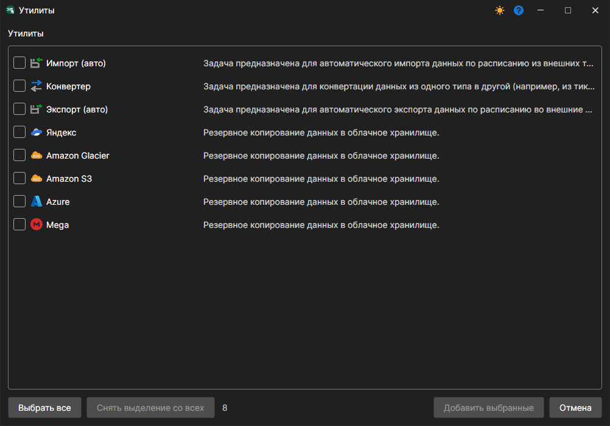

Для каждого добавленного источника Гидра спросит, включить ли его сейчас. Включённый источник скачивает данные, когда нажата кнопка **Старт**, выключенный пропускается. Ответьте **Да**.

Источник появится на панели **Задачи** слева, а в центре откроется его панель: таблица инструментов, под ней — настройки получаемых данных, справа — настройки подключения.

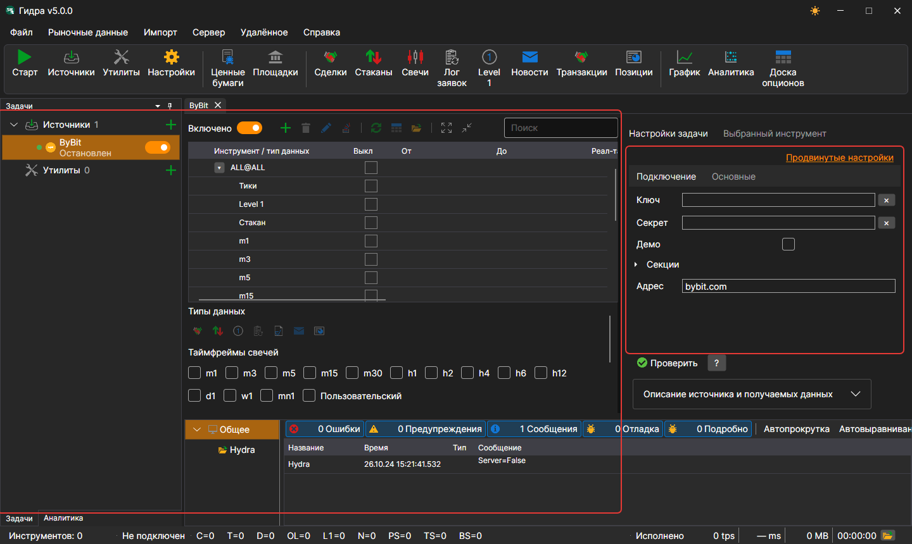

## Инструменты

> [!TIP]
> Данные скачиваются только по инструментам, добавленным в источник.

Сразу после добавления в источнике есть только служебный инструмент **ALL@ALL** — «все инструменты источника». По нему скачиваются те данные, которые источник умеет отдавать сразу по всем своим инструментам. Для примера добавим спотовую пару BTCUSDT.

1. Нажмите кнопку **Добавить инструменты**  над таблицей инструментов. Откроется окно выбора: слева — инструменты, которые знает Гидра, справа — выбранные для источника.

   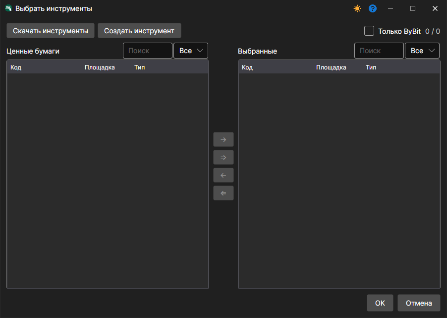

2. В первый раз список слева пуст: Гидра ещё не знает ни одного инструмента. Нажмите **Скачать инструменты**. В открывшемся окне задаются условия поиска; флажок **Все** запрашивает у источника весь список.

   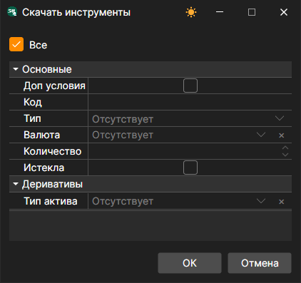

   Для ряда источников вместо всего списка можно [указать](prepare_for_download/instruments_list.md) нужные инструменты.

3. Нажмите **OK**. Когда источник ответит, Гидра сообщит, сколько новых инструментов добавлено, и они появятся в списке слева. Счётчик над списком показывает, сколько инструментов видно и сколько известно всего; флажок **Только ByBit** прячет инструменты, которые уже скачивают другие источники.

   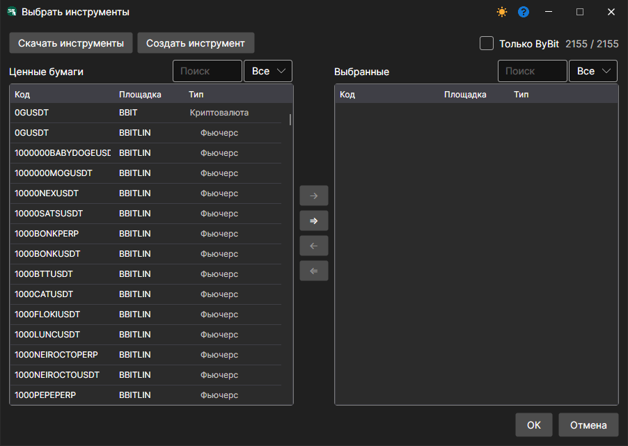

4. Начните вводить код инструмента в поле **Поиск** над списком.

   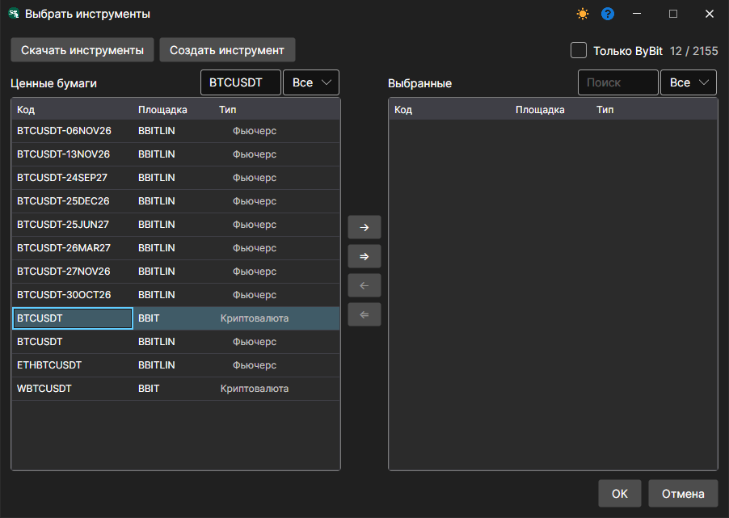

5. Перенесите инструмент вправо двойным щелчком или кнопкой со стрелкой и нажмите **OK**.

   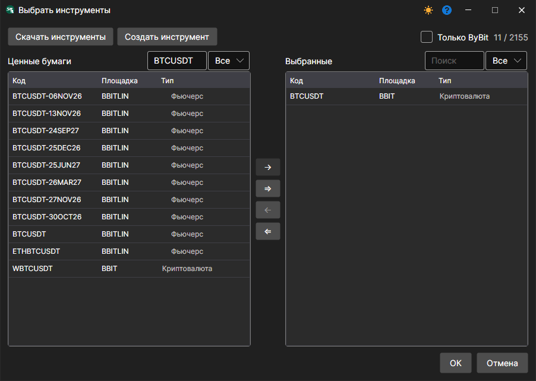

## Типы данных и период

После выбора инструментов Гидра спросит, какие данные по ним скачивать. Отметим **Тики** и пятиминутные свечи **ТФ: 00:05:00** — каждый щелчок добавляет к выбору ещё один тип.

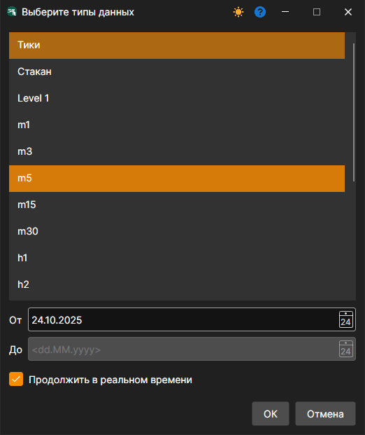

Дата **От** — начало истории. Флажок **Продолжить в реальном времени** оставляет источник получать данные и после того, как история скачана; дата **До** при нём не нужна. Сколько истории отдаёт источник, зависит от него самого.

После **OK** инструмент появится в таблице источника. Таблица древовидная: в строке инструмента — его код, под ним — выбранные типы данных с датами начала и конца.

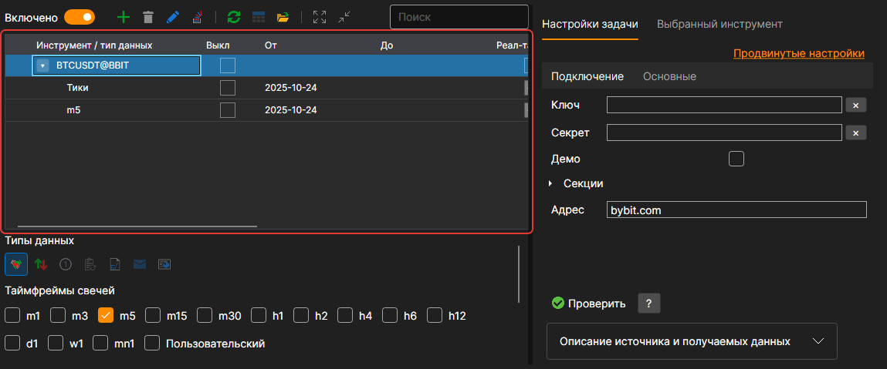

Если для инструмента не выбрано ни одного типа данных или у него не заданы шаг цены, шаг объёма или число знаков после запятой, слева в его строке появляется значок ⚠. Подсказка на значке объясняет, чего не хватает.

Под таблицей — настройки выделенных в ней строк. Выделите одну или несколько строк, и настройки применятся ко всем им сразу:

- **Типы данных** — какие данные получать. Набор зависит от источника.

  

- **Таймфреймы свечей** — какие свечи скачивать. Список таймфреймов тоже зависит от источника; **Пользовательский** открывает окно, где задаётся [свой тип свечей](prepare_for_download/custom_candles.md).

  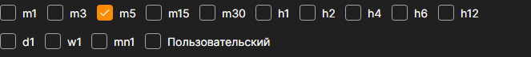

- **От** и **До** — период скачивания. Без даты окончания источник скачивает всё, что есть на сегодня, а если умеет работать в реальном времени и отмечен флажок **Реал-тайм**, продолжает получать данные и дальше.

  **Построение свечей** — откуда брать свечи: **Загрузить** — готовыми у источника, **Построение** — строить самой Гидрой, **Загрузить и построить** — загружать, а недостающие строить. **Поле построения** — из чего строить: из цены последней сделки, середины спреда, лучшей цены и т. д. Строить свечи удобно, когда источник не отдаёт их нужного таймфрейма.

  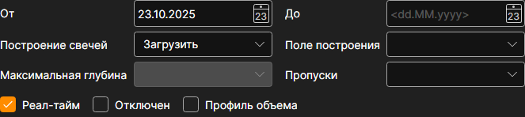

## Скачивание

Нажмите **Старт** на панели инструментов. Источник подключится и начнёт скачивание. Ход работы виден в панели **Логи** внизу окна, а строка состояния считает полученные данные: **C** — свечи, **T** — тики и так далее. Логи также сохраняются в файлы в папке Гидры.

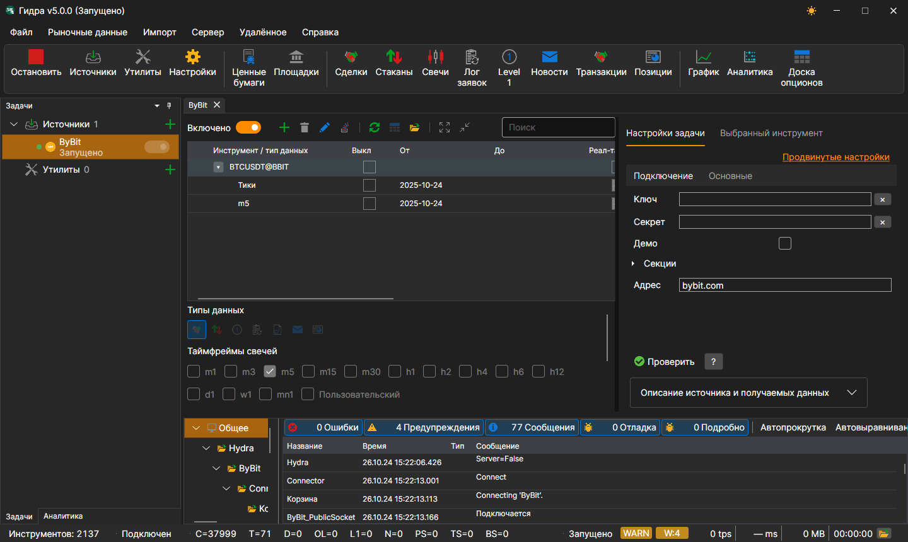

Также можно добавить [другие источники](data_sources/select_source.md).

Скачанные данные можно [просмотреть](working_with_data/view_and_export.md), по ним можно [построить свечи](working_with_data/candles_generation.md), их можно [экспортировать](working_with_data/export_data.md) в различные форматы.

**Смотреть [видеоинструкцию](videos/first_start.md)**
