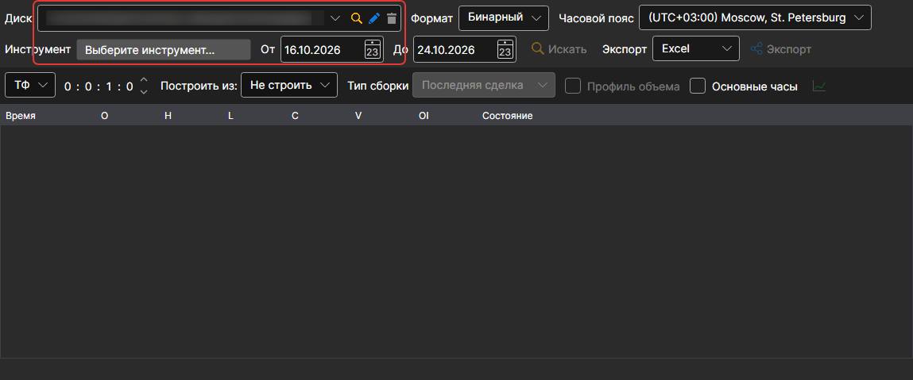
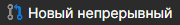
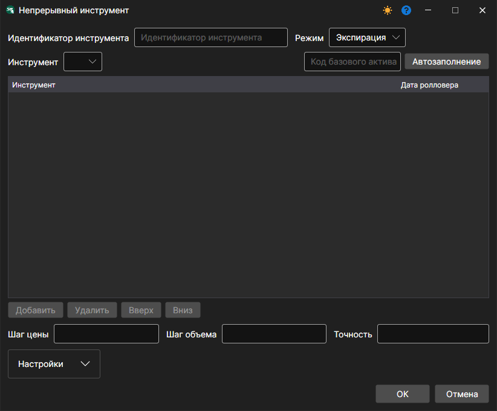
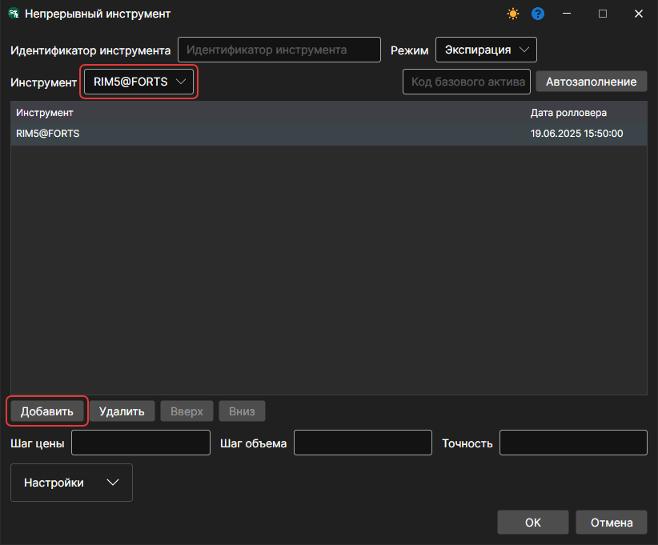
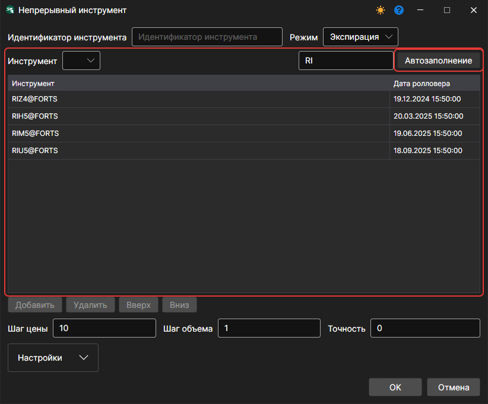
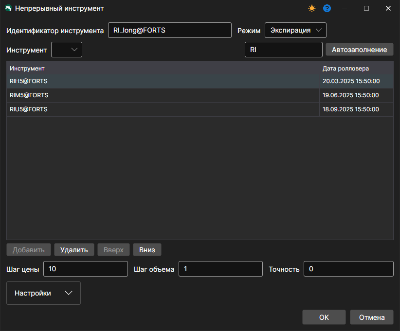
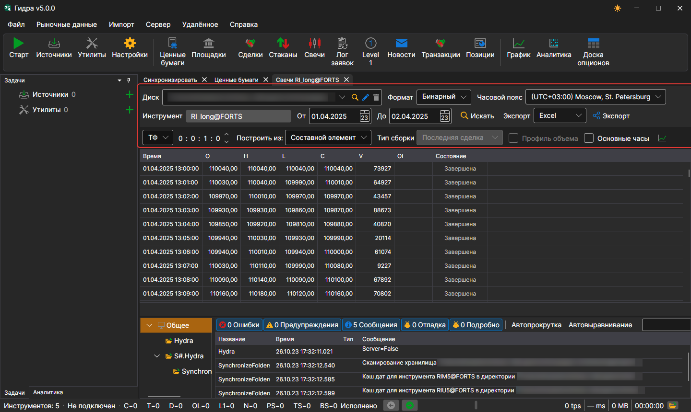

# Непрерывный фьючерс

Программа [Hydra](../../hydra.md) предоставляет пользователю возможность склеить различные виды маркет\-данных по разным контрактам в один непрерывный инструмент.

Для этого в меню **Рыночные данные** нужно выбрать пункт **Ценные бумаги**, появится панель **Ценные бумаги**.

Перед тем как склеивать данные, необходимо проверить, какие маркет\-данные есть. Для этого выбирается путь, где лежат данные, и по очереди просматриваются инструменты, которые предполагается склеить. Если имеются пропуски, то необходимо докачать нужные маркет\-данные (например, с **Финама**).

В качестве примера будет рассмотрено склеивание по фьючерсу на индекс RTS.

1. Для создания непрерывного фьючерса необходимо на панели **Ценные бумаги** нажать кнопку **Новый непрерывный**.

   После этого появится окно следующего вида:
2. Для создания непрерывного фьючерса необходимо задать имя и добавить контракты.

   Добавить контракты можно двумя способами.
   - Вручную: выбрать контракт в списке **Инструмент** и нажать кнопку **Добавить**.
   - Если в поле **Код базового актива** задать первые две буквы контракта, например, RI, и нажать кнопку **Автозаполнение**, то будут добавлены все найденные в БД контракты с датами их экспирации.
3. Выбираем нужные контракты и устанавливаем даты перехода. 
4. Далее назначаем идентификатор инструмента **RI\_long@FORTS** и нажимаем кнопку **ОК**, после чего создастся новый инструмент.
5. Далее необходимо выбрать пункт [Свечи](../working_with_data/view_and_export/candles.md) в меню **Рыночные данные**, выбрать полученный инструмент, период данных, в поле **Построить из:** установить значение **Составной элемент**. После чего нажать кнопку.

Сгенерированные данные можно экспортировать в форматы Excel, xml, Json или txt. Экспорт выполняется при помощи раскрывающегося списка:

