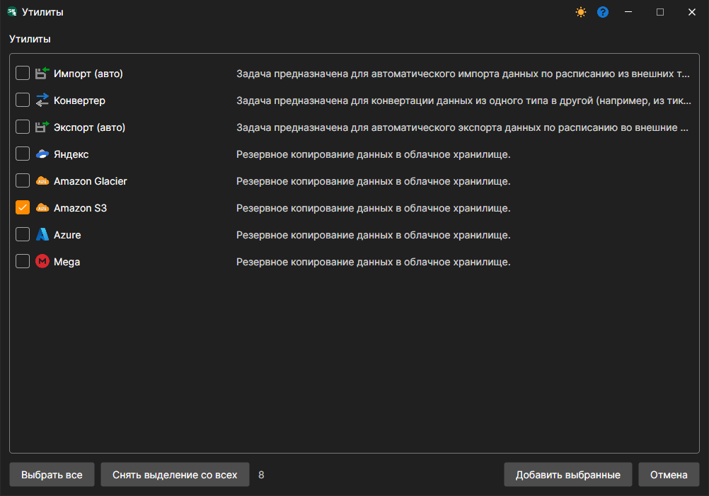
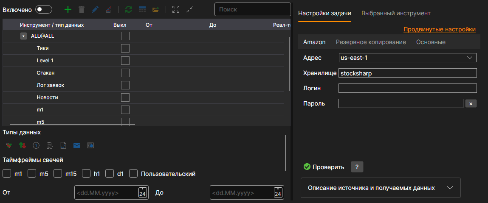

# Создание и настройка задачи

Далее описано создание и настройка задачи резервного копирования.

1. Для создания задачи необходимо нажать кнопку **Утилиты**, в открывшемся окне отметить пункт **Amazon S3** и нажать кнопку **Добавить выбранные**. На вопрос, включить ли задачу сейчас, можно ответить **Нет** \- задача включается переключателем после настройки.
2. Далее следует настроить задачу. Настройки разбиты на вкладки, а ссылка **Продвинутые настройки** показывает их все одним списком.

   **Amazon**
   - **Адрес** \- регион, указанный в настройках бакета. См. [регионы и конечные точки](https://docs.aws.amazon.com/general/latest/gr/rande.html#s3_region).
   - **Хранилище** \- имя бакета.
   - **Логин** \- ключ доступа **Access Key ID**.
   - **Пароль** \- ключ доступа **Secret Access Key**.

   **Резервное копирование**
   - **Папка** \- папка в облаке, в которую выгружаются данные. Если не задана, данные выгружаются в корень бакета.
   - **Временной отступ** \- отступ в днях от текущей даты, чтобы не копировать данные незавершённой торговой сессии.
   - **Ошибки** \- сколько раз повторяется неудавшаяся операция (создание папки, выгрузка файла), прежде чем задача сообщит об ошибке.

   **Основные**
   - **Продолжить** \- продолжать копирование с последней скопированной даты.
   - **Интервал работы** \- интервал работы задачи.
   - **Директория с данными** \- директория с данными, для которых выполняется резервное копирование.
   - **Формат** \- формат данных: BIN\/CSV.
   - **Макс. ошибок** \- максимальное количество ошибок, при достижении которого задача будет остановлена. По умолчанию 0 \- количество ошибок игнорируется.
   - **Заголовок** \- заголовок задачи.
   - **Рабочее время** \- расписание работы задачи. При установке галочки в поле становится доступна кнопка **...**, которая открывает редактор расписания.

   **Логирование**
   - **Уровень логирования** \- уровень логирования.
3. После настройки задачи нужно добавить инструменты, которые должны сохраняться в резервном хранилище, и нажать кнопку **Старт**.

## См. также

[Создание и настройка аккаунта](setup.md)
