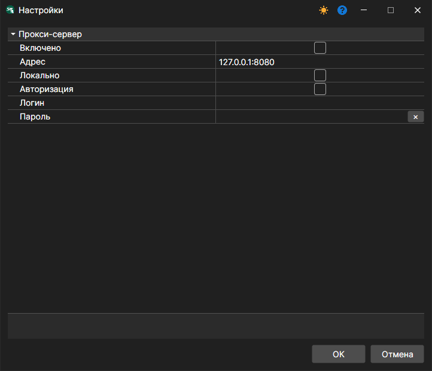

# Настройка сети

Меню **Файл \=\> Настройки прокси**. (Пункт **Сервер \=\> Настройки сети** — это настройки [режима сервера](../server_mode/settings.md).)

Позволяет настроить параметры прокси\-сервера.
