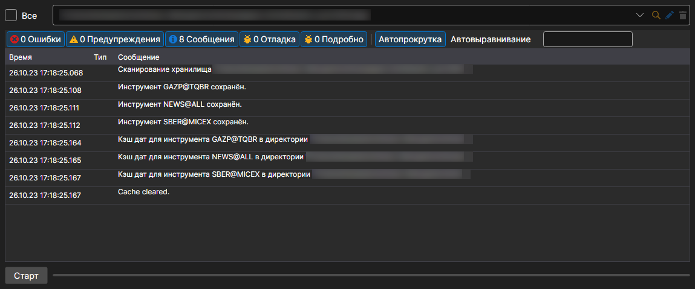

# Синхронизация данных

Меню **Импорт \=\> Синхронизировать**.

Позволяет восстановить инструменты по скачанным файлам.

Пункт **Импорт \=\> Построить индекс** пересобирает индекс хранилища — список того, какие данные за какие дни в нём лежат. Hydra перестраивает индекс и сама, с интервалом, который задаётся в общих настройках.
