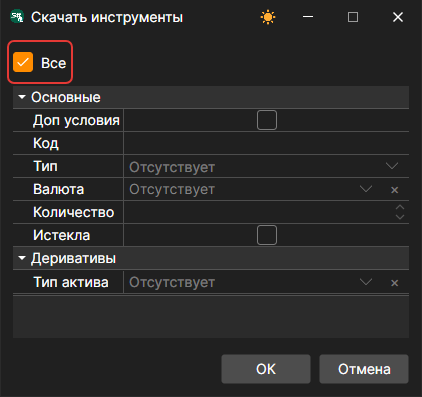
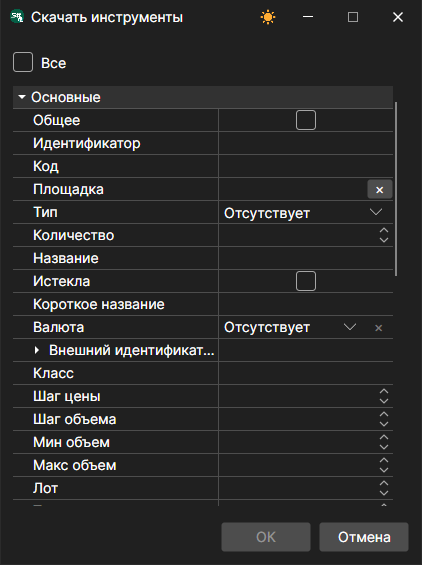
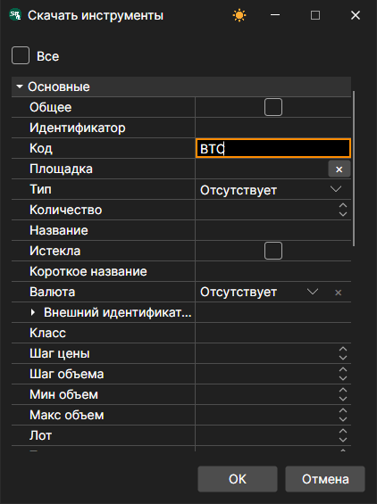
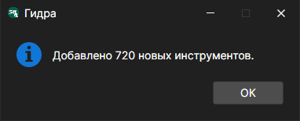
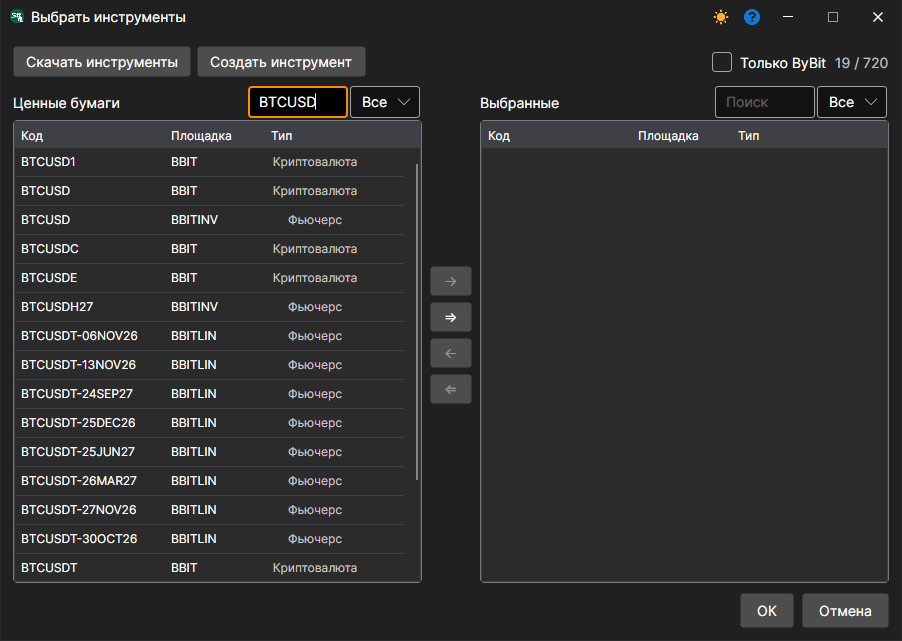
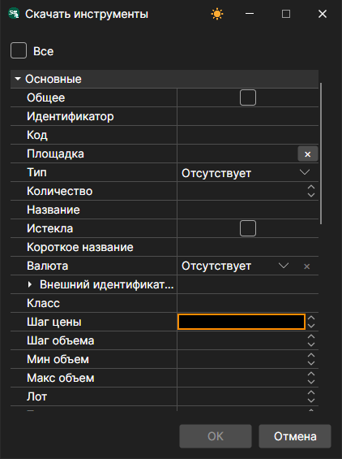
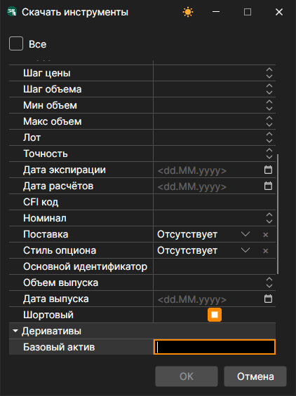

# Настройка инструмента для скачивания

Настройка инструмента для скачивания.

Для ряда источников существует возможность сделать настройки для скачивания нужных инструментов.

Рассмотрим на примере скачивания инструментов с источника **ByBit**:

1. Нажимаем **Скачать инструменты**. По умолчанию отмечен пункт **Все** \- будут скачаны все инструменты источника.
2. Снимаем отметку **Все** и отмечаем **Доп условия**. После этого раскроется список расширенных настроек для скачиваемого инструмента; отметка **Общее** возвращает краткий список.
3. Нужно скачать инструменты, в коде которых есть BTC. Для этого указываем BTC в поле **Код** и нажимаем **OK**.

   После этого программа [Hydra](../../hydra.md) скачает все инструменты, отвечающие установленным параметрам, и сообщит, сколько из них новых. 

Настройка позволяет пользователю выбрать различные параметры для загружаемого инструмента.

Так, например, пользователь может выбрать:

- **Шаг цены и объема**
- **Минимальный и максимальный объемы**
- **Внешний идентификатор** 
- Для опционов позволяет настроить **Базовый актив** и **Тип актива** (тип базового инструмента).

**Смотреть [видеоинструкцию](../videos/instruments_downloading.md)**
