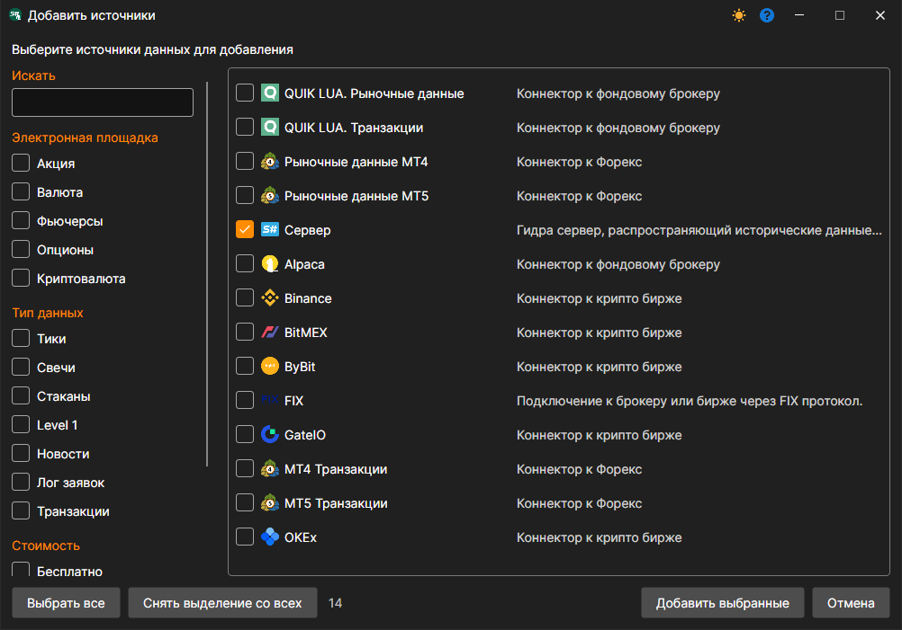
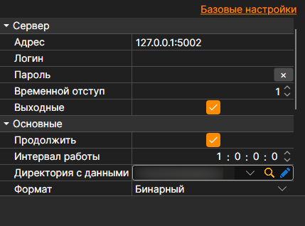

# Подключение Hydra-клиент

В случае серверного режима возможно подключение другой программы Hydra, которая будет выступать в роли клиента, и скачивать данные себе. В отличие от [Подключения через FIX протокол](fix_fast_connectivity.md) данные транслируются в виде файлов в формате StockSharp. Что делает источник ориентированным для передачи большого объема исторических данных.

Для подключения используется источник **Сервер**: его нужно отметить в окне, которое открывается кнопкой **+** у раздела **Источники**, и нажать **Добавить выбранные**.

**Настройки**

**Сервер**

- **Адрес** \- адрес Hydra-сервера.
- **Логин** \- логин (требуется, если сервер требует авторизации).
- **Пароль** \- пароль (требуется, если сервер требует авторизации).
- **Временной отступ** \- временной отступ в днях от текущей даты, который необходим для предотвращения скачивания неполных данных за текущую торговую сессию.
- **Выходные** \- пропускать ли выходные дни.

**Основные**

- **Продолжить** \- продолжать скачивание с последней скачанной даты.
- **Интервал работы** \- интервал работы.
- **Директория с данными** \- директория с данными, куда будут сохраняться конечные файлы в формате [S\#](../../api.md).
- **Формат** \- формат данных: BIN\/CSV.
- **Макс. ошибок** \- максимальное количество ошибок, по достижению которого задача будет остановлена. По умолчанию 0 \- количество ошибок игнорируется.
- **Заголовок** \- заголовок задачи.
- **Рабочее время** \- расписание работы задачи.
- **Проверка** \- что делать с данными, не прошедшими проверку: ничего, удалять их или останавливать подписку.

**Удалённое**

- **Включено** \- управлять задачей удалённо.
- **Уведомление** \- канал, в который приходят уведомления о задаче.
- **Уровень логирования** \- какие сообщения задачи отправлять в канал.

**Логирование**

- **Уровень логирования** \- уровень логирования.
