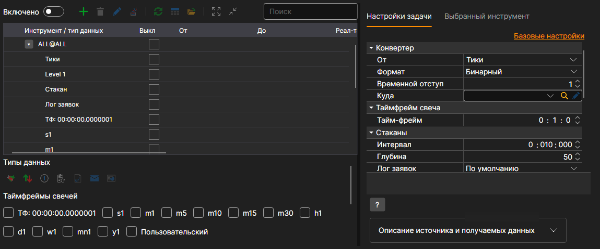
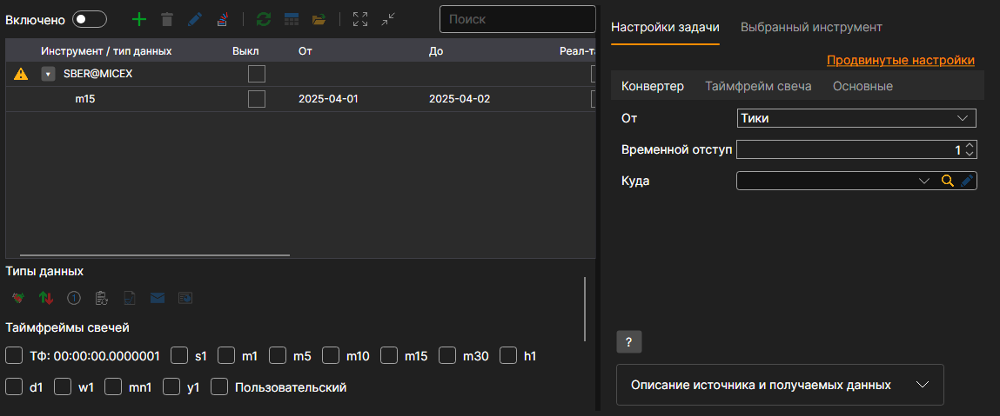
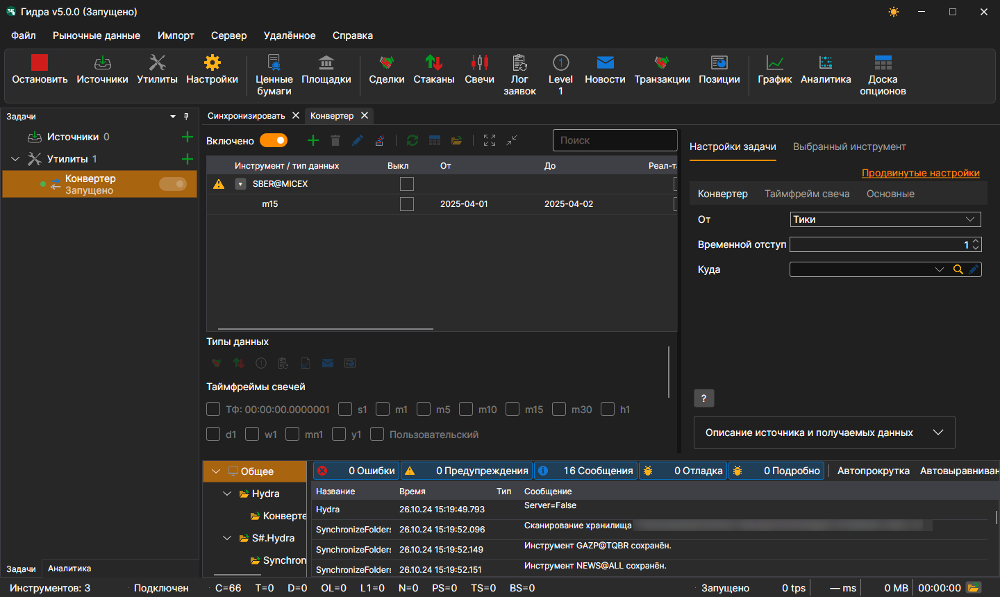
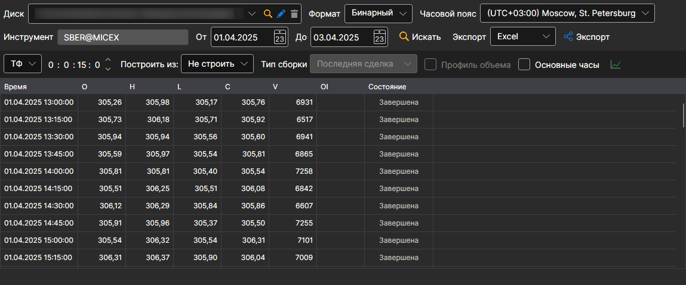

# Конвертер

Задача выполняет конвертацию биржевых данных. Например, из Логов заявок в тики или тиков в свечи и т.п.

Задача добавляется кнопкой **Утилиты**: в открывшемся окне нужно отметить пункт **Конвертер** и нажать кнопку **Добавить выбранные**. Настройки задачи разбиты на вкладки, а ссылка **Продвинутые настройки** показывает их все одним списком.

**Конвертер**

- **От** \- какой тип данных будет конвертирован.
- **Формат** \- формат сконвертированных данных: BIN\/CSV.
- **Временной отступ** \- временной отступ в днях от даты запуска задачи. Необходим для избежания конвертирования данных не за полный день. Если настроена конвертация данных в режиме реального времени, существует вероятность конвертации данных не за полный день из\-за настроек интервала обновления. Чтобы избежать этого, устанавливается временной отступ.
- **Куда** \- директория с данными, куда будут сохраняться сконвертированные данные.

**Таймфрейм свеча**

- **Тайм\-фрейм** \- тайм\-фрейм свечей, из которых выполняется конвертация, если в поле **От** выбраны свечи.

**Стаканы**

- **Интервал** \- интервал генерации стаканов.
- **Глубина** \- максимальная глубина генерации стаканов.
- **Лог заявок** \- как строить стаканы из лога заявок.

  **По умолчанию** подходит в большинстве случаев. Если у подключения свой формат лога заявок (например, **Plaza** у Московской Биржи), этот формат появляется в списке, когда подключение установлено.

  

**Основные**

- **Продолжить** \- продолжать конвертацию с последней сконвертированной даты.
- **Интервал работы** \- интервал работы.
- **Директория с данными** \- директория с данными, откуда будут получены данные для конвертации.
- **Формат** \- формат конвертируемых данных: BIN\/CSV.
- **Макс. ошибок** \- максимальное количество ошибок, по достижению которого задача будет остановлена. По умолчанию 0 \- количество ошибок игнорируется.
- **Заголовок** \- Конвертер.
- **Рабочее время** \- расписание работы задачи. 

**Логирование**

- **Уровень логирования** \- уровень логирования.

Рассмотрим пример конвертации данных.

1. Переходим в задачу **Конвертер** и добавляем инструмент кнопкой **+** над таблицей. 
2. В появившемся окне устанавливаем тип данных, которые мы должны получить при конвертации, и период. Тип данных, из которого производится конвертация, задаётся в настройке **От**.

   Например, необходимо Тики сконвертировать в свечи с Тайм Фреймом 15 мин.

   > [!TIP]
   > ВАЖНО\! Период данных, которые надо получить, должен соответствовать периоду данных имеющихся для конвертации, иначе данные не будут сконвертированы. В настройках важно указать правильный формат конвертируемых данных, нужно чтобы формат соответствовал формату конвертируемых данных.
3. Устанавливаем необходимые директории. Временной отступ. Интервал работы.
4. Включаем задачу переключателем **Включено** и запускаем конвертацию кнопкой **Старт**. 

Видно, что данные сконвертированы. [Просмотрим](../working_with_data/view_and_export.md) полученные данные.

Данная функция схожа с [получением нужных маркет\-данных](../working_with_data/any_market_data_types.md) из данных другого типа.

**Смотреть [видеоинструкцию](../videos/converter_task.md)**
