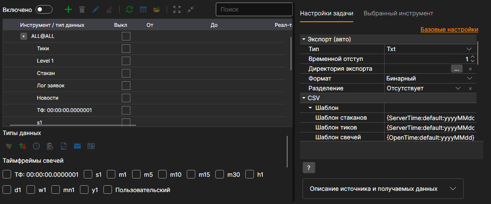
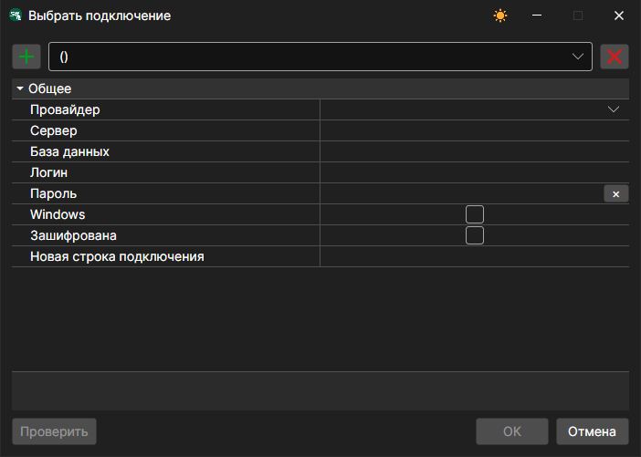
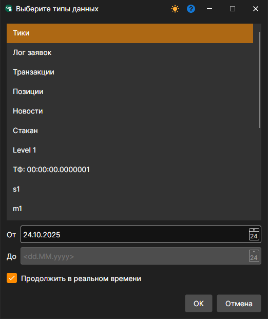
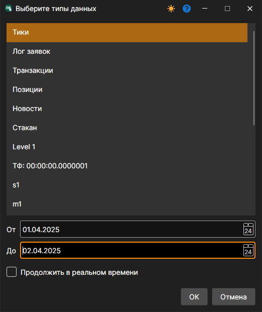
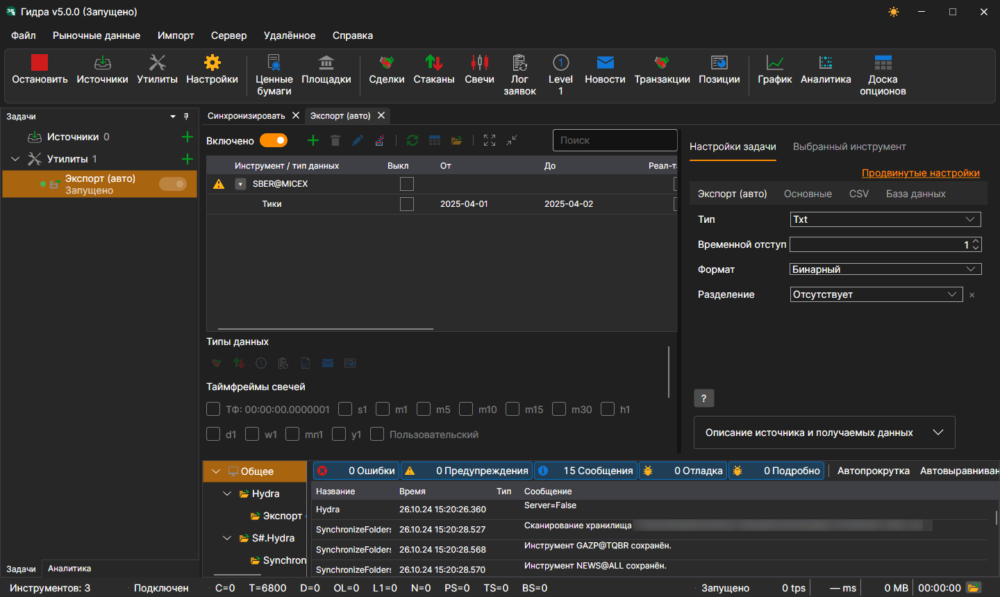

# Экспорт (авто)

Задача выполняет экспорт биржевых данных в различные форматы: Excel, xml, sql, bin, Json или txt.

Задача добавляется кнопкой **Утилиты**: в открывшемся окне нужно отметить пункт **Экспорт (авто)** и нажать кнопку **Добавить выбранные**. Настройки задачи разбиты на вкладки, а ссылка **Продвинутые настройки** показывает их все одним списком.



**Экспорт (авто)**

- **Тип** \- тип экспорта (формат).
- **Временной отступ** \- временной отступ в днях.
- **Директория экспорта** \- директория, куда будут экспортироваться данные. Если она не задана, файлы сохраняются в директорию с данными.
- **Формат** \- формат данных.
- **Разделение** \- тип разделения: по дням, месяцам или годам.

**База данных**

- **Подключение** \- подключение к базе данных. Используется в случае экспорта через SQL.
- **Пакет** \- размер пакета передаваемых данных. По умолчанию равен 50 элементам. Используется в случае экспорта через SQL.
- **Уникальность** \- проверять уникальность данных в базе данных. Влияет на производительность. По умолчанию включено. Используется в случае экспорта через SQL.

> [!TIP]
> При использовании экспорта через SQL нужно задать подключение к базе данных

Окно подключения открывается кнопкой с лупой в поле **Подключение**, а кнопка **+** в нём добавляет новое подключение:



- **Провайдер** \- настройки провайдера.
- **Сервер** \- адрес сервера или путь к базе данных.
- **База данных** \- название базы данных. Не используется для SQLite.
- **Логин** \- логин для доступа к базе данных. Не используется при анонимном доступе.
- **Пароль** \- пароль для доступа к базе данных. Не используется при анонимном доступе.
- **Windows** \- использовать текущую учетную запись Windows для подключения к базе данных.
- **Зашифрована** \- шифровать соединение с сервером.
- **Новая строка подключения** \- готовая строка подключения.

> [!TIP]
> Проверить соединение с базой можно при помощи кнопки "Проверить".

**CSV**

- **Шаблон** \- шаблоны для каждого типа экспортируемых данных.
- **Заголовок** \- заголовок идущий первой строкой. Если передается пустая строка, то заголовок не будет добавлен в файл.
- **Формат имени файла** \- формат записи имени экспортируемого файла.

**Основные**

- **Продолжить** \- продолжать экспорт с последней экспортированной даты.
- **Интервал работы** \- интервал работы.
- **Директория с данными** \- директория с данными, откуда берутся экспортируемые данные.
- **Формат** \- формат данных: BIN\/CSV.
- **Макс. ошибок** \- максимальное количество ошибок, по достижению которого задача будет остановлена. По умолчанию 0 \- количество ошибок игнорируется.
- **Заголовок** \- название задачи.
- **Рабочее время** \- расписание работы задачи. 

**Логирование**

- **Уровень логирования** \- уровень логирования.

Рассмотрим пример автоматического экспорта:

1. Выбираем инструмент кнопкой **+** над таблицей.
2. Устанавливаем маркет данные которые необходимо экспортировать.
3. Устанавливаем период экспорта. Если настроено скачивание маркет данных в режиме реального времени, то можно не указывать дату окончания периода. В таком случае данные будут экспортироваться в режиме реального времени, в соответствии с интервалом работы (обновления данных). 
4. Настраиваем директории. Интервал работы. Тип данных. Формат данных.
5. Включаем задачу переключателем **Включено** и запускаем экспорт кнопкой **Старт**.

Просмотрим экспортированные данные. Тики SBER@MICEX за 1 и 2 апреля, выгруженные в тип **Txt** по шаблону тиков по умолчанию, лежат в файле `trades_SBER@MICEX_2025_04_01_2025_04_02.csv` и начинаются так:

```
20250401;10:00:00.000000;15500000;305.26;88;Buy
20250401;10:00:09.000000;15500001;305.23;2;Sell
20250401;10:00:18.000000;15500002;305.20;48;Sell
20250401;10:00:27.000000;15500003;305.22;46;Buy
20250401;10:00:36.000000;15500004;305.28;105;Sell
```

**Смотреть [видеоинструкцию](../videos/export_task.md)**
