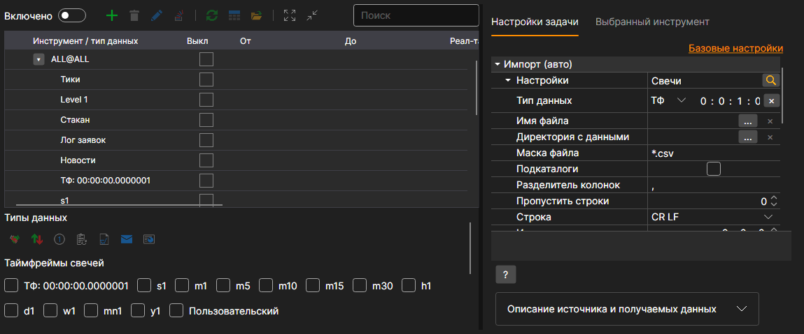
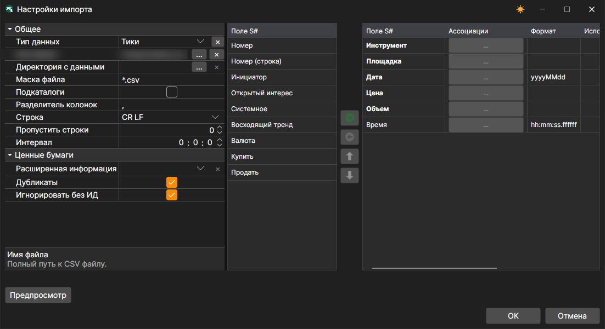
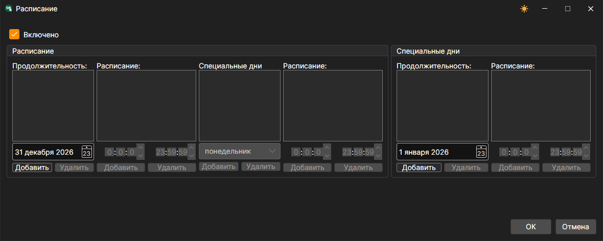
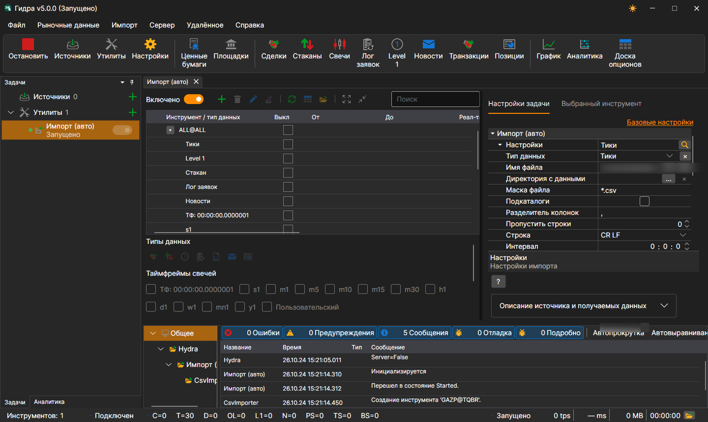

# Импорт (авто)

Задача выполняет автоматический импорт биржевых данных из файлов в указанном каталоге по заданной маске файла.

Задача добавляется кнопкой **Утилиты**: в открывшемся окне нужно отметить пункт **Импорт (авто)** и нажать кнопку **Добавить выбранные**. Ссылка **Продвинутые настройки** показывает все настройки задачи одним списком.

Что и откуда импортировать, задаётся в строке **Настройки**. Кнопка с лупой в этой строке открывает окно, где, кроме тех же настроек, колонки файла сопоставляются с полями S\# \- так же, как на вкладке [Импорт данных](../importing.md):

**Настройки**

- **Тип данных** \- тип импортируемых данных.
- **Имя файла** \- полный путь к файлу.
- **Директория с данными** \- директория с файлами, если импортируется не один файл, а все подходящие файлы каталога.
- **Маска файла** \- маска файла, которая используется при сканировании директории. Например, candles\*.csv.
- **Подкаталоги** \- включать подкаталоги.
- **Разделитель колонок** \- разделитель колонок. Табуляция обозначается TAB.
- **Строка** \- окончание строки в файле: CR LF, LF или CR.
- **Пропустить строки** \- количество строчек, которые нужно пропустить с начала файла (если они несут метаинформацию).
- **Интервал** \- периодичность обновления данных.
- **Расширенная информация** \- сохранить расширенные импортированные поля в хранилище расширенной информации.
- **Дубликаты** \- нужно ли обновлять дубликаты инструментов, если они уже существуют.
- **Игнорировать без ИД** \- игнорировать инструменты без идентификатора.

**Основные**

- **Продолжить** \- продолжать импорт с последней импортированной даты.
- **Интервал работы** \- интервал работы.
- **Директория с данными** \- директория с данными, куда будут сохраняться конечные файлы в формате [S\#](../../api.md).
- **Формат** \- формат данных: BIN\/CSV.
- **Макс. ошибок** \- максимальное количество ошибок, по достижению которого задача будет остановлена. По умолчанию 0 \- количество ошибок игнорируется.
- **Заголовок** \- название задачи.
- **Рабочее время** \- расписание работы задачи. 

**Логирование**

- **Уровень логирования** \- уровень логирования.

Рассмотрим пример автоматического импорта тиков. В файле `ticks.csv` каждая сделка записана строкой вида `GAZP,TQBR,20250401,128.58,74,10:00:02.000000`: инструмент, площадка, дата, цена, объём и время.

1. Кнопкой с лупой в строке **Настройки** открываем окно настроек импорта.
2. Выбираем тип данных **Тики** и указываем в поле **Имя файла** путь к файлу.
3. Добавляем к полям S\# поле **Время**: обязательные поля \- инструмент, площадка, дата, цена и объём \- уже стоят в том порядке, в каком колонки идут в файле, и время дописывается за ними. Нажимаем **OK**.
4. Включаем задачу переключателем **Включено** и запускаем импорт кнопкой **Старт**. 
