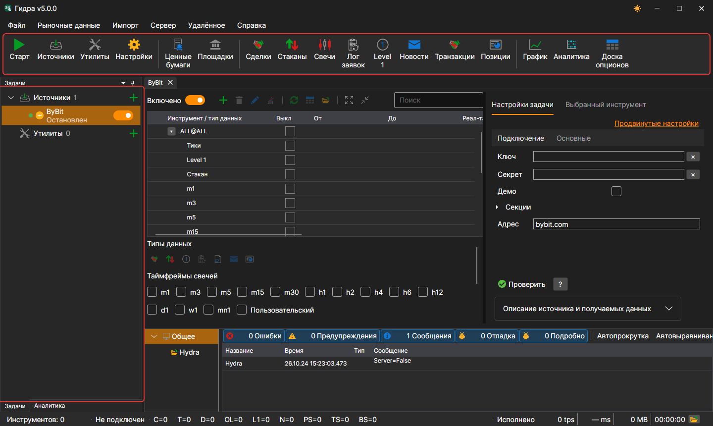
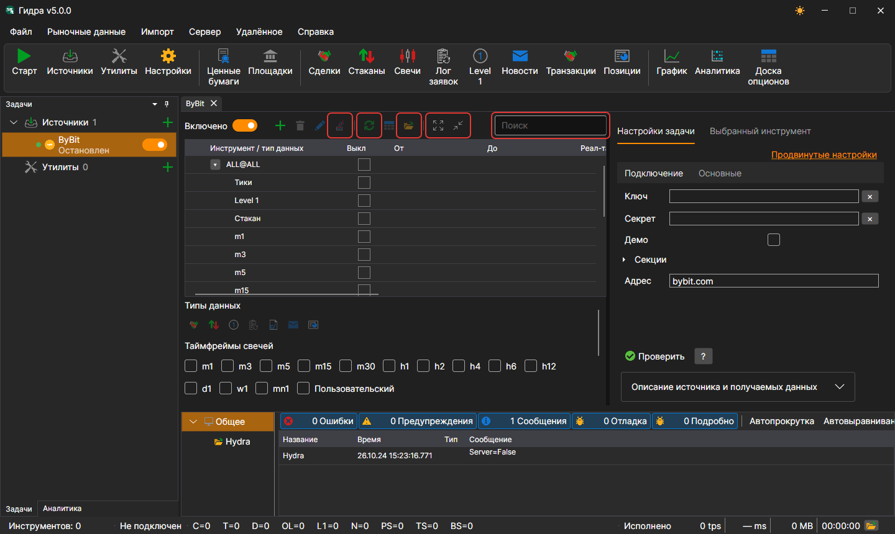

# Интерфейс программы

Окно [Hydra](../hydra.md) состоит из меню, панели команд под ним, панелей **Задачи** и **Аналитика** слева, панели **Логи** снизу и документов в центре: панелей источников, утилит и маркет-данных. Внизу окна — строка состояния.

## Меню

- **Файл** — добавление [источников](data_sources.md) и утилит, [общие настройки](misc/settings.md), [настройки прокси](misc/network_settings.md), [сброс настроек](misc/settings_reset.md) и выход.
- **Рыночные данные** — панели просмотра маркет-данных хранилища: инструменты, площадки, сделки, стаканы, свечи, лог заявок, Level 1, новости, транзакции, позиции, а также [график](working_with_data/chart.md), аналитика и доска опционов.
- **Импорт** — [импорт](importing.md) данных из файлов, [синхронизация](misc/synchronization.md) хранилища и построение его индекса.
- **Сервер** — [режим сервера](server_mode/settings.md): включение, настройки сети, пользователи и подписки клиентов.
- **Удалённое** — удалённое управление Hydra через Telegram\-бота ([Панель управления](../telegram_services/control_panel.md)) и окно **Каналы** со списком каналов Telegram, в которые Hydra отправляет сообщения.
- **Справка** — смена темы оформления, связь с командой StockSharp, сообщение о проблеме, документация и окно **О программе**.

На macOS меню переходит в системную строку меню.

## Панель команд

Под меню — панель команд с самыми частыми действиями: **Запустить/остановить все задачи**, добавление источников и утилит, настройки; панели **Инструменты** и **Площадки**; панели маркет-данных — сделки, стаканы, свечи, лог заявок, Level 1, новости, транзакции и позиции; **График**, **Аналитика** и **Доска опционов**.

## Задачи

На панели **Задачи** слева задачи разложены по группам **Источники** и **Утилиты**. У группы видно число задач и кнопка **+**, которая добавляет новую. У задачи — точка (зелёная, если задача включена), значок, имя, строка с её текущим состоянием и переключатель; значок часов показывает, что у задачи задано рабочее время. Двойной щелчок открывает панель задачи, правый щелчок — меню с пунктами **Открыть** и **Удалить**.

Пока в центре окна ничего не открыто, там показан экран приветствия с кнопками **Добавить источники** и **Добавить утилиты**.

Пока идёт долгая работа — например, читается большое хранилище или добавляется источник, — окно закрыто полупрозрачной подложкой с описанием того, что сейчас делается.

## Панель задачи

Над таблицей инструментов источника — поиск, переключатель **Включено**, кнопки добавления, удаления и изменения инструментов, **Добавить ALL@** (все инструменты источника разом), синхронизация дат, переход к данным и к папке хранилища, свернуть и развернуть строки. На вкладке настроек есть кнопка проверки подключения и описание источника, а на вкладке **Выбранный инструмент** — свойства выделенного в таблице инструмента.

## Строка состояния

Внизу окна видно, сколько инструментов в хранилище, подключена ли Hydra, сколько данных каждого вида получено с запуска, чем программа занята сейчас и последнее предупреждение или ошибка журнала. Кнопка с папкой открывает папку журналов. Пока идёт долгая операция — чтение большого хранилища, добавление источника, — окно закрывается подложкой с описанием работы.

## См. также

[Первый запуск](first_start.md)

[Источники данных](data_sources.md)
