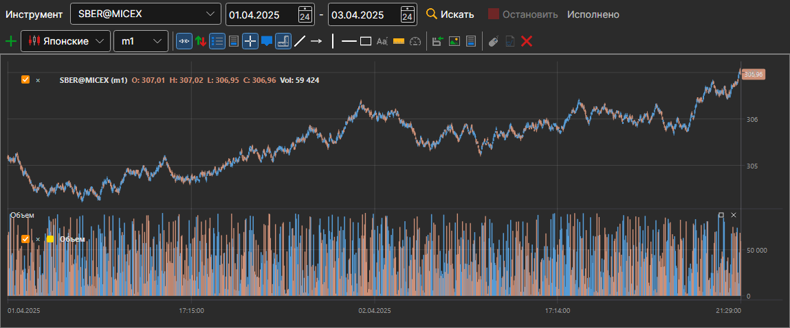

# График

Панель **График** показывает свечи любого инструмента, который есть в хранилище. Она открывается пунктом **Рыночные данные → График** или кнопкой **График** на панели команд.

В строке над графиком выбираются **Инструмент** и период — дата начала и дата конца, — а затем нажимается **Найти**. Свечи читаются из хранилища и рисуются по мере чтения; **Стоп** прерывает чтение, а строка рядом с кнопками показывает, как идёт работа.

Ниже — полноценный график, такой же, как в [Terminal](../../terminal/user_interface/components/chart.md): с панелью кнопок, стилями свечей, индикаторами и рисованием. На график можно добавить [индикатор](view_and_export/indicators.md), а кнопка **Остановить отрисовку** останавливает долгую отрисовку большого периода.

## См. также

[Генерация свечек](candles_generation.md)

[Просмотр маркет-данных](view_and_export.md)
