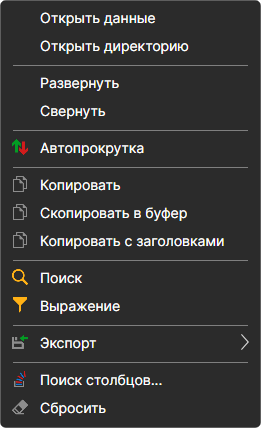
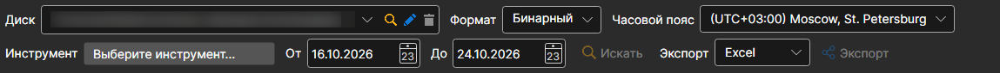
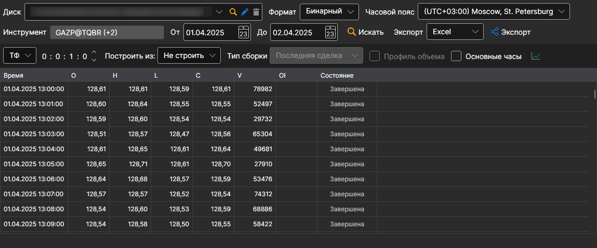
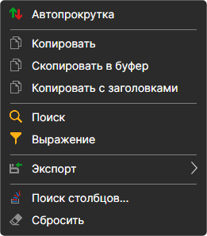

# Просмотр маркет\-данных

Полученные данные [Hydra](../../hydra.md) можно просмотреть в специальных панелях. 

Для этого в меню **Рыночные данные** нужно выбрать один из пунктов: [Тики](view_and_export/ticks.md), [Стаканы](view_and_export/order_books.md), [Свечи](candles_generation.md), [Лог заявок](view_and_export/order_log.md), [Level 1](view_and_export/level_1_.md), [Новости](view_and_export/news.md), [Транзакции](view_and_export/transactions.md), [Доска опционов](view_and_export/option_desk.md), [Индикаторы](view_and_export/indicators.md), [Позиции](view_and_export/positions.md).

Панель с данными задачи открывается и из её таблицы инструментов: двойным щелчком по типу данных или пунктом **Открыть данные** контекстного меню, как показано на рисунке.

Каждая панель имеет общий интерфейс настроек следующего вида:

- В верхней строке указываются хранилище маркет\-данных (**Диск**), их **Формат** (бинарный или CSV) и **Часовой пояс**, в котором показывается время.
- Во второй строке выбираются инструменты и период, за который будут запрошены данные. При нажатии на кнопку **Выберите инструмент** появится окно выбора инструментов, в котором можно выбрать один или несколько инструментов. Если будут выбраны несколько инструментов, то при последующем экспорте в Excel или CSV программа сама отсортирует данные разных инструментов по разным файлам.
- Найденные данные загружаются в таблицу порциями по тысяче строк: следующая порция подгружается сама, когда таблица прокручена к концу, поэтому листать можно сколько угодно далеко, не дожидаясь загрузки всего периода. Сортировка по колонке упорядочивает уже загруженные строки, а экспорт кнопками панели записывает все данные за выбранный период, а не только загруженные.
- Если данные были получены из источников, чей часовой пояс не совпадает с текущим часовым поясом, то можно настроить временной пояс. Тогда, после построения, полученные данные будут иметь время выбранного пользователем пояса. 
- Так как ряд источников не предоставляет возможность скачать некоторые данные, в программе предусмотрено поле ["Построить из"](any_market_data_types.md). Используя данное поле, пользователь получает возможность строить маркет\-данные из маркет\-данных другого типа. Эта же функция может быть применена для построения маркет\-данных без дополнительного скачивания, используя за основу уже имеющиеся данные. 
- После того как выбраны указанные выше параметры, необходимо нажать кнопку **Искать** . Пока идёт поиск или экспорт, под строками настроек показывается его ход и кнопка **Остановить**. Когда экспорт закончен, там же появляется кнопка **Открыть файл** или **Открыть папку** с его результатом.

Контекстное меню таблицы со значениями позволяет включить автопрокрутку, скопировать выделенные строки в буфер обмена, найти значение, отфильтровать строки выражением, экспортировать таблицу в файл, буфер обмена или на печать, выбрать показываемые колонки и сбросить их расположение.

