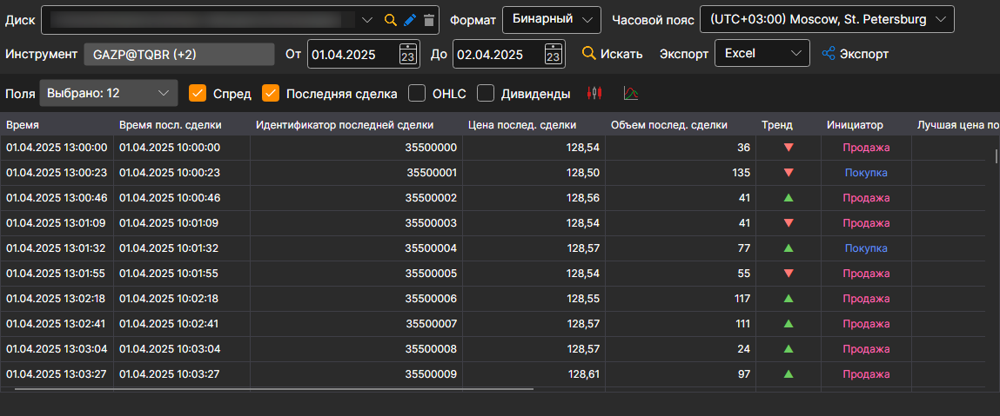
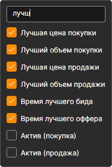

# Level 1 

В появившемся окне выбрать интересуемый диапазон времени, выбрать инструмент и нажать кнопку :

Список **Поля** задаёт, какие значения Level 1 показываются в таблице и попадают в экспорт. Отметьте нужные поля в раскрывающемся списке; строка поиска вверху списка оставляет только поля, в названии которых есть набранный текст:

Полученные значения можно [экспортировать в нужный формат](../export_data.md).
