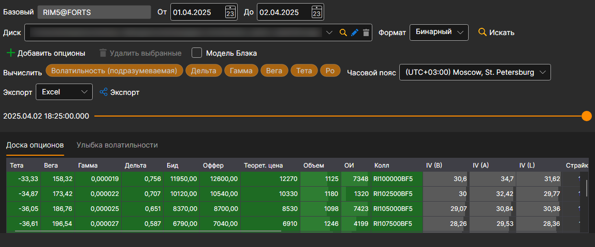
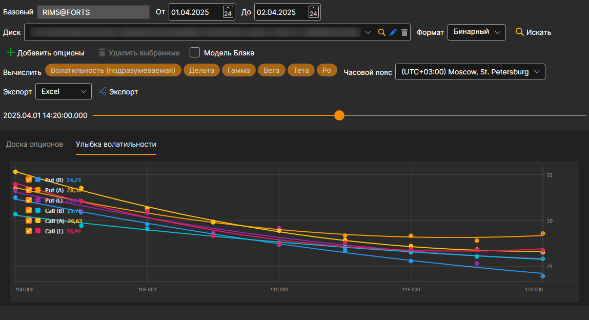

# Доска опционов

В появившемся окне выбрать базовый актив — опционы на него добавятся на доску сами, а диапазон времени встанет на тот, за который в хранилище есть данные. Кнопкой **Добавить опционы** можно добавить другие опционы, кнопкой **Удалить выбранные** — убрать лишние. Затем нажать кнопку :

Если истории "греков" нет, но есть данные по спреду, основные "греки" (Дельта, Гамма, Вега, Тета, Ро, Волатильность (подразумеваемая)) можно рассчитать: для этого их нужно отметить в поле **Вычислить**. Волатильность рассчитывается по цене покупки, продажи и последней сделки, а остальные "греки" — по волатильности середины спреда.

Ползунок над доской переносит её в любой момент загруженной истории; слева от ползунка показано время этого момента. Когда ползунок доведён до последнего загруженного момента, подгружается следующая часть истории.

Для просмотра **Улыбки волатильности**, необходимо перейти на вкладку **Улыбка волатильности**.

Полученные значения можно [экспортировать в нужный формат](../export_data.md).
