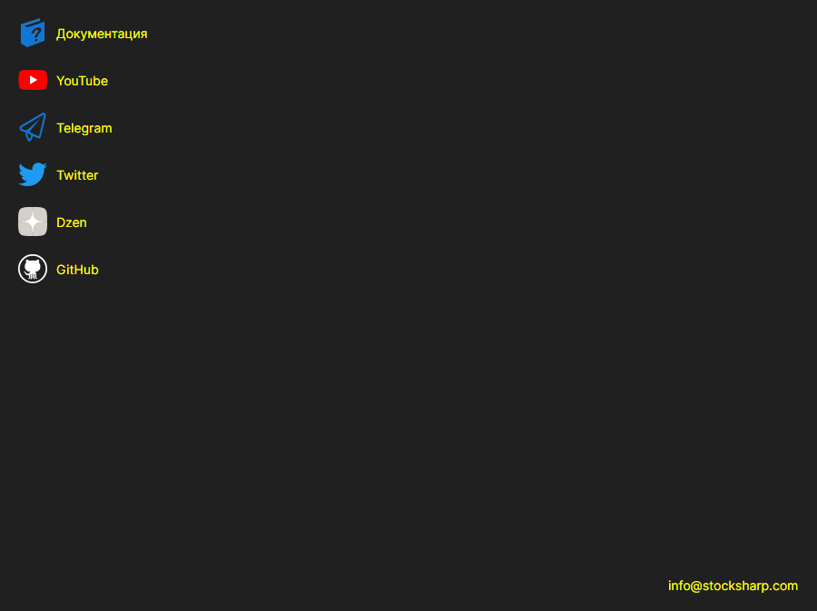

# Справка

Страница **Справка** открывается одноимённой вкладкой в верхней части окна [Installer](../installer.md).

Страница собирает ссылки, за которыми чаще всего идут из [Installer](../installer.md): **Документация**, **YouTube**, **Telegram** (чат поддержки), **Twitter**, **Dzen** и **GitHub**. Ссылка открывается в браузере, установленном в системе по умолчанию. Внизу страницы — адрес почты, по которому можно написать в компанию.

Сообщить о проблеме можно кнопкой в заголовке окна — она есть на любой странице. Если [Installer](../installer.md) повёл себя не так, как ожидалось, приложите к сообщению записи со страницы [Логи](logs.md) — по ним видно, что именно происходило.

## См. также

[Логи](logs.md)
