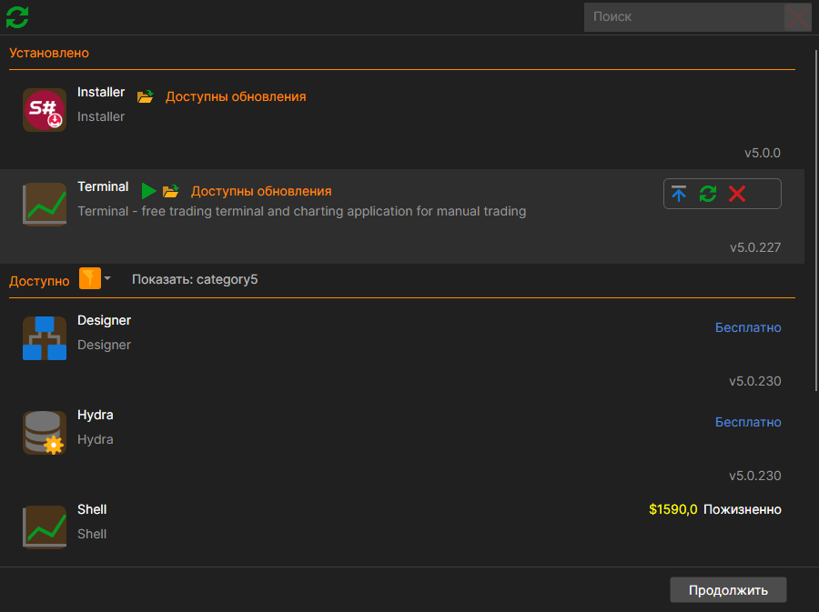
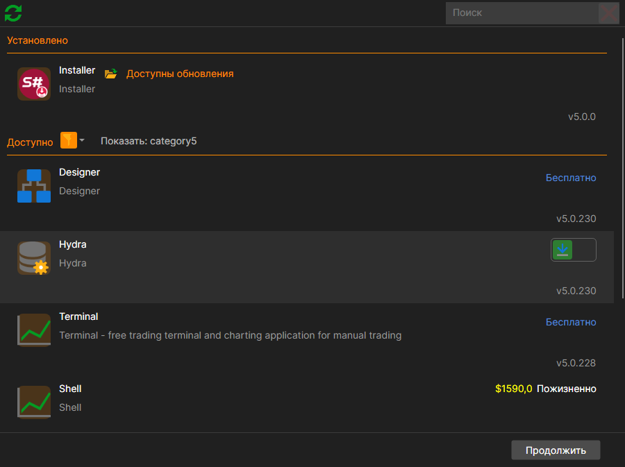
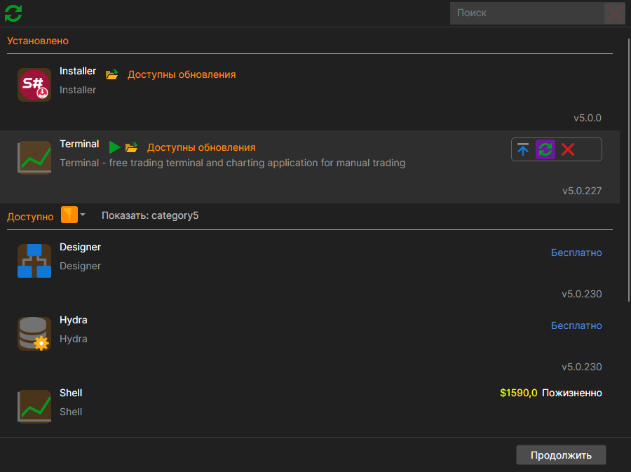
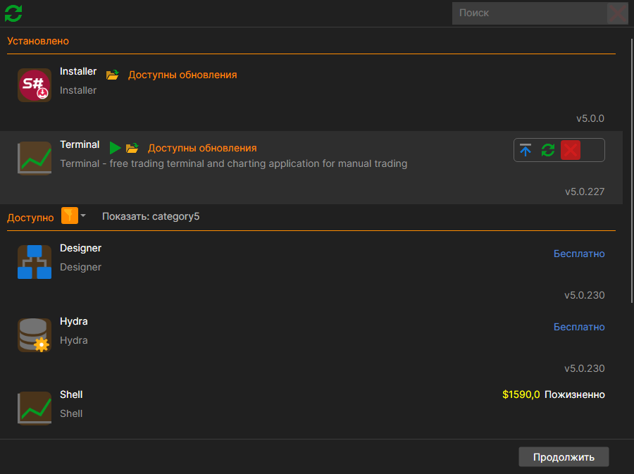
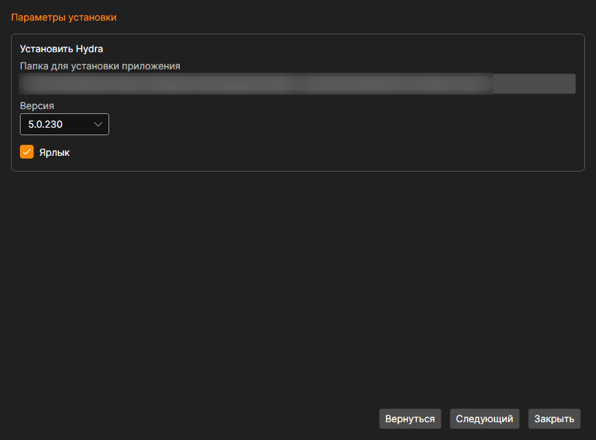

# Установка и удаление программ

Всё, что [Installer](../installer.md) делает с программами, делается на вкладке **Приложения**: и установка, и обновление, и восстановление, и удаление. Действие отмечается у продукта в списке, а выполняются все отмеченные разом.

## Каталог

Список разбит на две части: **Установлено** — то, что уже стоит на этом компьютере, и **Доступно** — то, что можно поставить. Если в части ничего нет, вместо неё написано **Пусто**.

Найти нужное помогают:

- поле **Поиск** над списком — список сужается по мере ввода, крестик рядом возвращает его целиком;
- воронка у заголовка **Доступно** — фильтр по типу продукта, кнопка **Все** снимает его;
- кнопка с круговой стрелкой слева вверху — **Принудительная проверка обновлений**: спрашивает магазин, не вышло ли чего нового, не дожидаясь, когда подойдёт очередная проверка.

У установленного продукта в строке показана его версия, а если вышла новая — надпись **Доступны обновления**.

## Лицензионное соглашение

Внизу окна — флажок с согласием и ссылкой на текст соглашения. Пока оно не принято, кнопка **Продолжить** остаётся недоступной, что бы ни было отмечено. Согласие принимается один раз и на стороне сервера — после этого флажок больше не показывается, и снять его назад нельзя.

## Что сделать с продуктом

У каждой строки справа — набор кнопок, из которых выбирается одна. Какие из них есть, зависит от продукта:

| Кнопка | Когда доступна | Что делает |
|---|---|---|
| **Установить** | продукт не установлен | ставит его |
| **Обновить** | установлен и вышла новая версия | обновляет |
| **Восстановить** | установлен | ставит поверх заново, не трогая настройки |
| **Удалить** | установлен | удаляет |
| **Пропустить** | всегда | ничего не делать с этим продуктом |

У неустановленного продукта выбор один — поставить:

У установленного — восстановление:

и удаление:

Кнопка **Продолжить** внизу справа оживает, как только отмечено хотя бы одно действие. Отметить можно сразу несколько продуктов — например, один обновить, другой удалить. Когда всё отмечено, нажмите **Продолжить** внизу справа.

## Мастер

Дальше окно показывает мастер из трёх шагов вместо списка.

1. **Приложения** — что именно будет сделано. Проверьте список и нажмите **Продолжить**.
2. **Параметры установки** 

   Для каждого действия здесь свои настройки:

   - **Папка для установки приложения** — выбирается кнопкой. **ВАЖНО\!** Папка должна быть пустой.
   - **Версия** и **Получатель** — какая версия ставится и для кого.
   - **Ярлык** — создать ярлык на рабочем столе.
   - **Удалите папку данных приложения** — только при удалении: снести вместе с программой её настройки и скачанные данные. Без этого флажка они останутся.
   - **Плагины** — для программ, которые их поддерживают: какие коннекторы поставить вместе с продуктом.
   - **Установить основные параметры приложения** — у продукта с плагинами можно снять этот флажок и работать только с плагинами, не трогая саму программу.

   Нажмите **Следующий**.
3. **Будут выполнены следующие действия** — последняя сверка. Нажмите **Выполнить**.

Пока идёт работа, показано **Выполняется. Пожалуйста, подождите...**, по окончании — **Исполнено**. Кнопка **Закрыть** возвращает к списку; **Вернуться** на любом шаге ведёт на предыдущий.

Если что-то не получилось, текст ошибки показывается прямо в мастере, а подробности — на странице [Логи](logs.md).

**Смотреть [видеоинструкцию](videos/install_and_remove_apps.md)**

## См. также

[Обновление программ](update_apps.md)

[Логи](logs.md)
