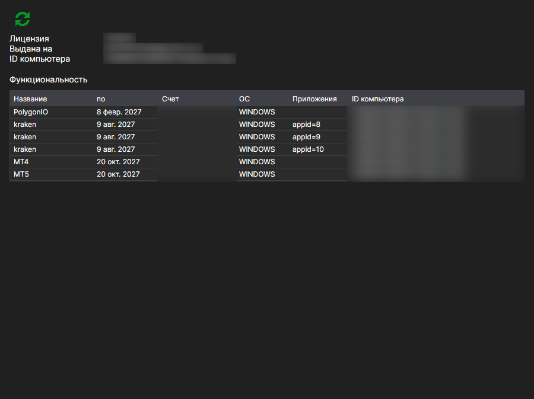

# Лицензии

Страница **Лицензии** открывается одноимённой вкладкой в верхней части окна [Installer](../installer.md) и доступна после входа в учётную запись.

Здесь видно, какая лицензия выдана этой учётной записи и на что она даёт право.

- **Выдана для** — на кого оформлена лицензия, и на какой компьютер она привязана: **Идентификатор диска** и **Операционная система**. По этой привязке сервер и решает, действительна ли лицензия на текущей машине.
- **Действует до** — дата окончания.
- **Продукты** — программы, на которые распространяется лицензия.
- **Возможности** — что именно разрешено: подключения к площадкам, количество инструментов, доступ к исходным кодам и прочее.

Кнопка **Обновить лицензию** перезапрашивает данные с сервера. Нажимать её имеет смысл после покупки или продления: [Installer](../installer.md) читает лицензию при входе, и изменение, сделанное на сайте позже, само собой в окне не появится.

Если лицензии нет, страница так и сообщает. Оформить её можно на странице [Тарифы](tariffs.md).

## См. также

[Тарифы](tariffs.md)
