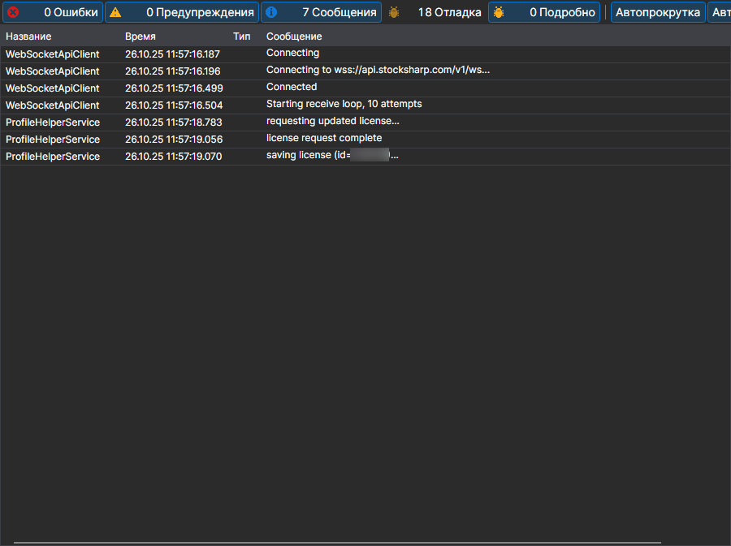

# Логи

Страница **Логи** открывается одноимённой вкладкой в верхней части окна [Installer](../installer.md).

Здесь [Installer](../installer.md) пишет, что он делал: к какому серверу обращался, какие пакеты скачивал, куда устанавливал и на чём остановился. Это первое место, куда стоит заглянуть, если установка или обновление завершились ошибкой.

Каждая запись содержит время, уровень (ошибка, предупреждение, сообщение) и текст. Насколько подробным будет журнал, задаётся параметром **Логирование** на странице [Настройки](settings.md): при обращении в поддержку его стоит поднять и повторить действие, которое не получилось, — тогда в журнале окажется причина, а не только сам факт ошибки.

## См. также

[Настройки](settings.md)
