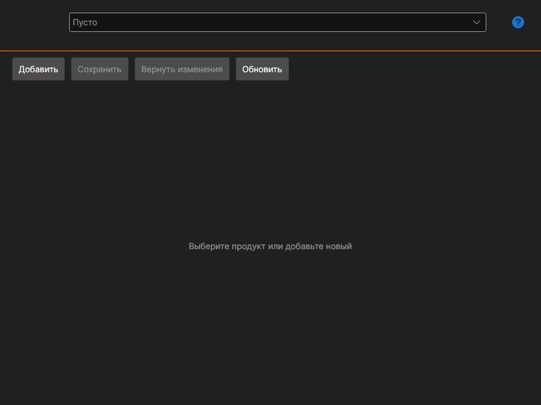

# Мои продукты

Страница **Мои продукты** открывается одноимённой вкладкой в верхней части окна [Installer](../installer.md) и доступна после входа в учётную запись.

Страница нужна тем, кто сам публикует продукты в [магазине](https://stocksharp.com/ru/store/) — роботов, индикаторы, коннекторы. Покупателю она не нужна: установка и обновление описаны в разделах [Установка и удаление программ](install_and_remove_apps.md) и [Обновление программ](update_apps.md).

## Карточка продукта

Продукт выбирается в списке вверху; кнопка **Добавить** заводит новый.

- **Название** и **Описание** — то, что увидит покупатель в магазине.
- **Идентификатор пакета NuGet** — под этим именем пакет уезжает в NuGet. Рядом показано, как он будет выглядеть целиком.
- **Тип содержимого** и **Область** — что это за продукт и где он применяется.
- **Категории** — разделы магазина, в которых продукт будет виден.
- **Ссылка на документацию** и **Ссылка на исходный код** — необязательные.
- **Иконка** — выбирается кнопкой; она же показывается в списке [Installer](../installer.md) у покупателя.

## Цена

Задаётся отдельно: разовая (**Бессрочно**), **В месяц** и **В год**, плюс цена продления. Незаполненная цена означает, что такого способа покупки нет.

## Доступ

Список пользователей задаёт, кому продукт виден помимо магазина: найдите пользователя через поиск и добавьте его. Так раздаётся доступ, например, внутри команды.

## Сохранение и публикация

**Сохранить** записывает изменения, **Отменить изменения** возвращает к последнему сохранённому состоянию, **Обновить** перечитывает список с сервера.

**Опубликовать** отправляет продукт на проверку. До её прохождения страница показывает, что продукт ещё не одобрен, а список ошибок внизу перечисляет, что нужно заполнить или исправить, — пока он не пуст, публикация не пройдёт.

## См. также

[Лицензии](licenses.md)
