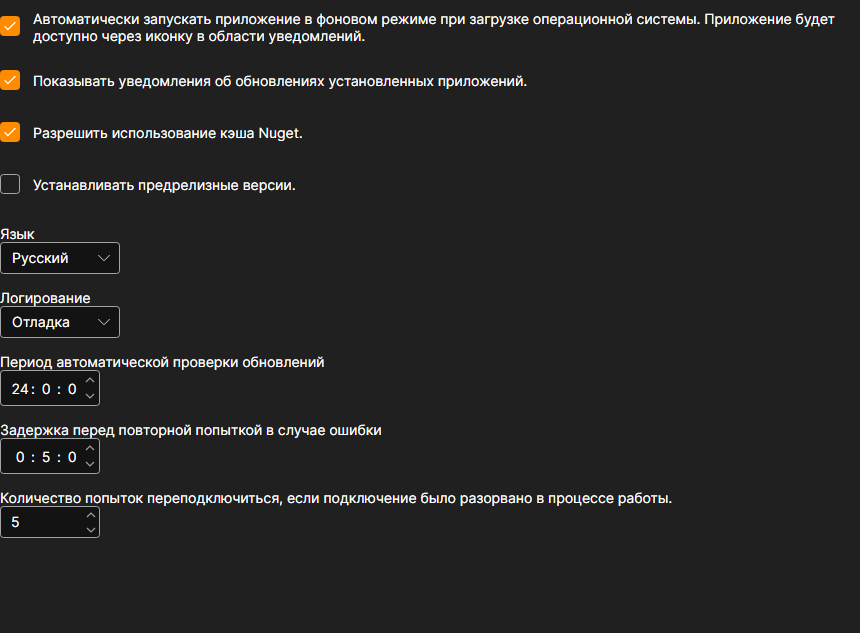

# Настройки

Страница **Настройки** открывается одноимённой вкладкой в верхней части окна [Installer](../installer.md).

## Что здесь можно изменить

- **Автоматически запускать приложение в фоновом режиме при загрузке операционной системы.** [Installer](../installer.md) стартует вместе с Windows и живёт в области уведомлений, откуда его и нужно закрывать — крестик в окне программу не выключает.
- **Показывать уведомления об обновлениях установленных приложений.** Без этой галочки [Installer](../installer.md) продолжает проверять обновления, но молча: о них можно узнать только на странице приложений. Как это выглядит — см. [Обновление программ](update_apps.md).
- **Разрешить использование кэша Nuget.** Пакеты, уже скачанные на этой машине, берутся с диска, а не из сети. Ускоряет повторную установку; выключается, если нужно гарантированно взять пакет заново.
- **Устанавливать предрелизные версии.** Кроме обычных релизов предлагаются предварительные сборки. Их стоит включать, только если вы понимаете, зачем вам ещё не вышедшая версия.
- **Язык.** Язык интерфейса самого [Installer](../installer.md).
- **Логирование.** Насколько подробно пишется журнал. Записи видно на странице [Логи](logs.md); при обращении в поддержку подробный уровень помогает быстрее найти причину.
- **Период автоматической проверки обновлений.** Как часто [Installer](../installer.md) спрашивает сервер о новых версиях, в часах.
- **Задержка перед повторной попыткой в случае ошибки.** Сколько ждать, прежде чем повторить неудавшуюся загрузку, в минутах.
- **Количество попыток переподключиться, если подключение было разорвано в процессе работы.** Сколько раз [Installer](../installer.md) пробует докачать пакет, прежде чем сообщить об ошибке.

Изменения применяются сразу и сохраняются — отдельной кнопки сохранения нет.

## См. также

[Логи](logs.md)
