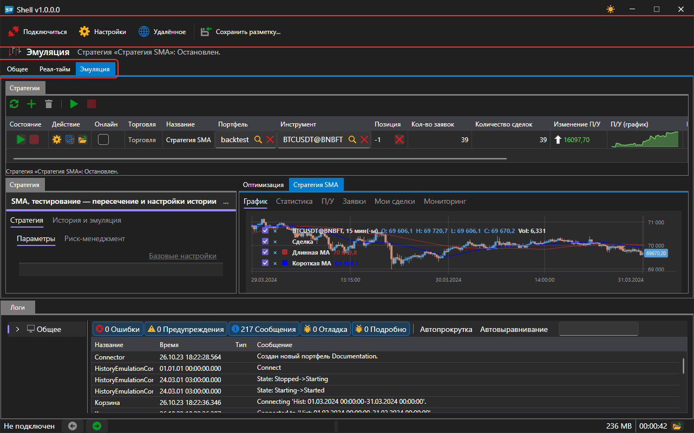
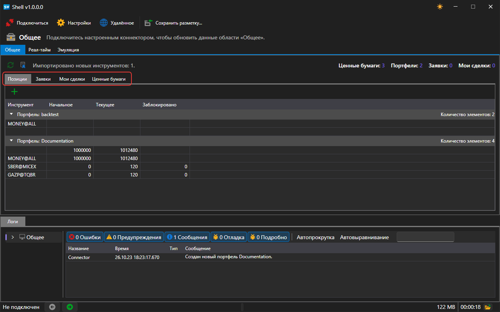
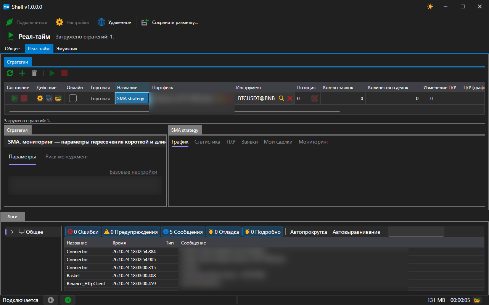
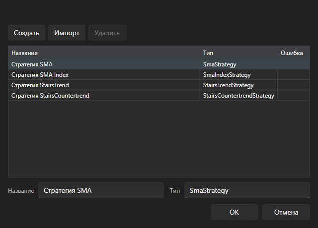
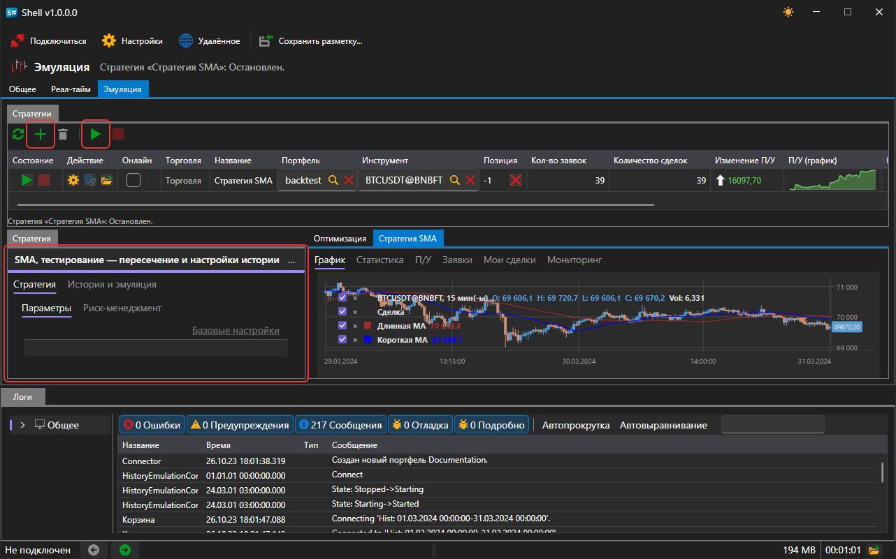

# Быстрый запуск

[Shell](../shell.md) \- это исходный код на [C\#](https://ru.wikipedia.org/wiki/C_Sharp), который открывают в Visual Studio, Rider или любой другой среде и запускают как обычное приложение:

```
dotnet run --project Shell.Avalonia/Shell.Avalonia/Shell.Avalonia.csproj
```

Предварительная настройка не нужна: проект запускается как есть и сразу работает на стратегиях, которые входят в поставку.

## Главное окно

После запуска открывается окно следующего вида:



Слева \- список рабочих областей, между которыми переключается приложение. Сверху \- строка команд: кнопка настроек подключения, кнопка **Подключиться** и сохранение текущей раскладки панелей. Внизу \- строка состояния с текущим состоянием подключения.

Всё, что Shell записывает \- настройки подключения, раскладку окон, список стратегий, импортированные схемы Designer и локальное хранилище котировок \- лежит в папке `Data` рядом с исполняемым файлом.

## Подключение

Перейдите в настройки подключения и выберите нужный коннектор. Как настроить подключение, описано в разделе [Настройки подключения](connections_settings.md).

Затем нажмите **Подключиться**. Состояние подключения отображается в строке состояния и рядом с кнопкой.

После подключения на вкладке [Общее](user_interface/common.md) появятся портфели, инструменты, заявки и собственные сделки, полученные из подключения.



## Стратегия в торговле

Перейдите на вкладку [Реал\-тайм](user_interface/real_time.md).



Нажмите **Добавить** и выберите стратегию в открывшемся окне.



Стратегия появится в таблице **Стратегии**, а её параметры \- на панели **Стратегия** слева. Заполните **Инструмент**, **Портфель**, объём и параметры самой стратегии, после чего нажмите **Запустить**.

Пока подключение не установлено, кнопки добавления и запуска в этой области недоступны \- об этом говорит подсказка под таблицей.

## Стратегия на истории

То же самое на вкладке [Эмуляция](user_interface/emulation.md) запускает стратегию не в торговлю, а на исторических данных.



Подключение для этого не нужно: каждый запуск читает историю с диска через собственный эмуляционный коннектор.

## См. также

[Общее](user_interface/common.md)

[Реал\-тайм](user_interface/real_time.md)

[Эмуляция](user_interface/emulation.md)
