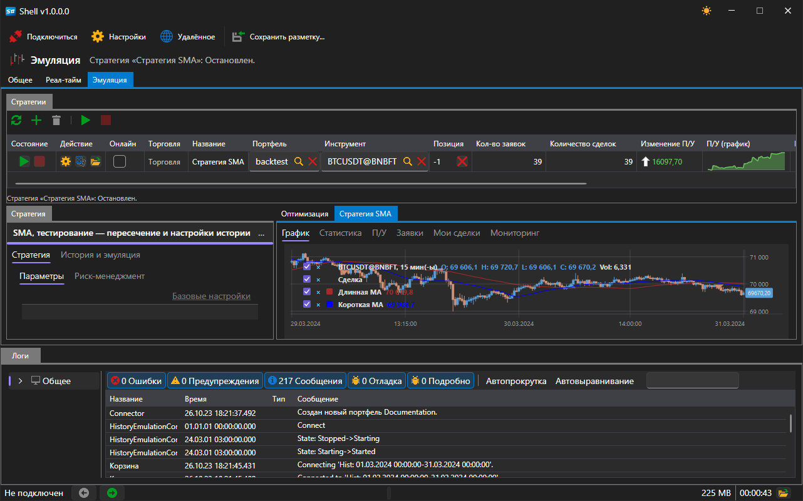

# Удалённое управление

[Shell](../shell.md) умеет отдавать свои стратегии под управление сайта: запущенная программа регистрируется как приложение вашей учётной записи, сообщает туда состояние каждой стратегии и выполняет приходящие оттуда команды. Так же устроено удалённое управление в [Hydra](../hydra.md) и [Designer](../designer.md), поэтому список программ и кнопки управления в [Telegram\-боте](../telegram_services/control_panel.md) выглядят одинаково для всех трёх.

## Включение

В строке команд главного окна есть переключатель **Удалённое**.

Пока он выключен, [Shell](../shell.md) никуда не подключается и на сайте не появляется. Включённое состояние запоминается и восстанавливается при следующем запуске программы.

Переключатель работает только тогда, когда программа запущена под учётной записью StockSharp и сайт доступен. Без входа в учётную запись включение ничего не даёт: соединение не открывается, приложение на сайте не регистрируется.

## Что доступно удалённо

Удалённо доступны стратегии области [Эмуляция](user_interface/emulation.md) \- те, что работают на истории. Стратегии области [Реал\-тайм](user_interface/real_time.md) намеренно недоступны: они торгуют на реальные деньги, и запустить такую стратегию можно только за самим компьютером. Ту же границу проводит и протокол межпроцессного взаимодействия, которым пользуются скрипты.

Отдельная стратегия появляется на сайте не сама по себе, а только если это разрешено в её настройках. Откройте стратегию в области [Эмуляция](user_interface/emulation.md), в её настройках найдите группу **Удалённое**:

| Настройка | Что задаёт |
|---|---|
| **Включено** | видит ли сайт эту стратегию и может ли ею управлять |
| **Уведомление** | канал, в который уходят её сообщения; если канал не выбран \- канал учётной записи |
| **Уровень логирования** | начиная с какого уровня сообщение стоит отправлять в канал |

Каналы берутся из учётной записи, поэтому список появляется после входа. Настройка канала в [Telegram](../telegram_services.md) описана в разделе [Авторизация](../telegram_services/authorization.md).

## Команды

С сайта или из бота приходят команды двух видов \- о программе целиком и об отдельной стратегии.

| Команда | Что делает |
|---|---|
| **Старт** для стратегии | запускает прогон, если он остановлен или завершился ошибкой |
| **Остановить** для стратегии | останавливает работающий прогон |
| **Старт** / **Остановить** без указания стратегии | то же самое сразу для всех стратегий, которым разрешено удалённое управление |
| **Включить** / **Выключить** торговлю | переводит стратегию в режим полной торговли или запрещает ей торговать; текущий прогон подхватывает это сразу |
| **Остановить** программу | закрывает [Shell](../shell.md) |
| **Перезапуск** программы | закрывает [Shell](../shell.md) и запускает его заново |

Команда, адресованная стратегии, которой удалённое управление не разрешено, игнорируется.

## Что уходит на сайт

- Состояние самой программы: запущена, пока окно открыто, и остановлена, когда оно закрыто.
- Состояние каждой разрешённой стратегии \- при каждом изменении.
- Сообщения стратегии, начиная с выбранного уровня, \- в выбранный канал. Одинаковые сообщения не повторяются.

## См. также

[Панель управления](../telegram_services/control_panel.md)

[Эмуляция](user_interface/emulation.md)
