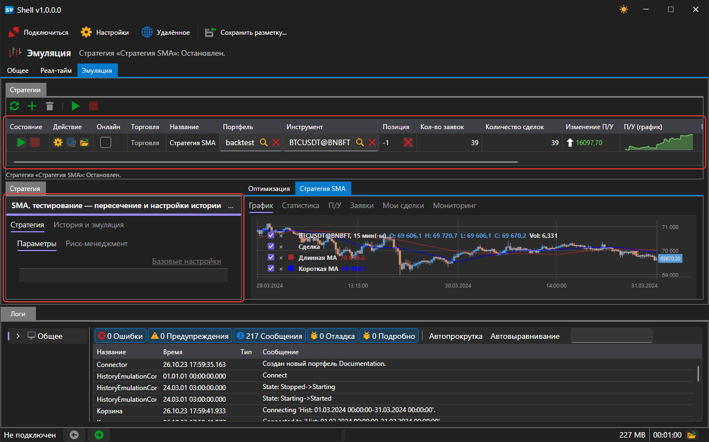
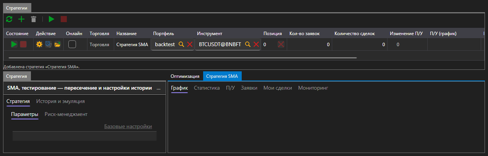
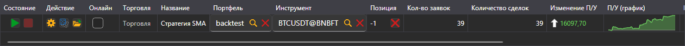
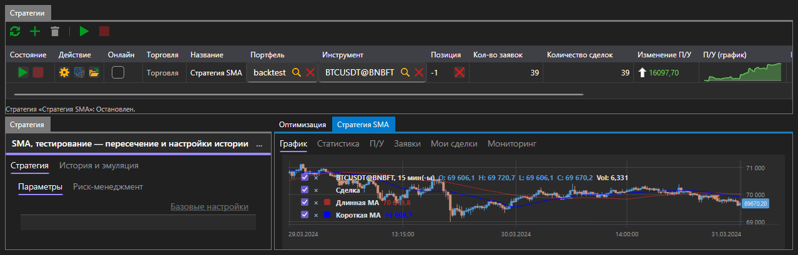
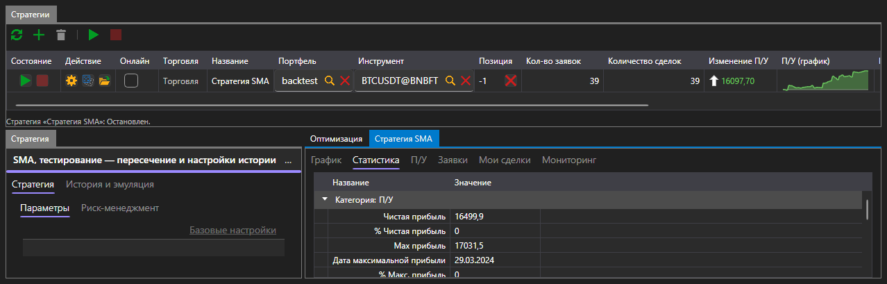
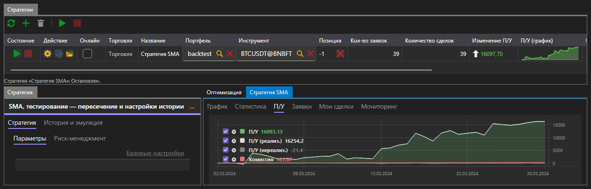
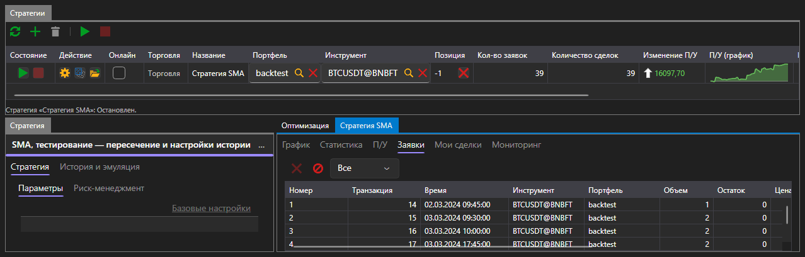
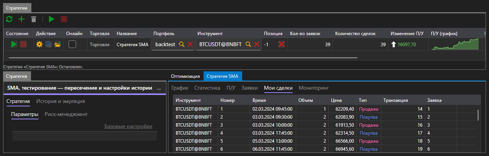

# Эмуляция

Вкладка **Эмуляция** прогоняет стратегию на исторических данных. Подключение для этого не нужно: каждый запуск читает историю с диска через собственный эмуляционный коннектор.

Область устроена так же, как [Реал\-тайм](real_time.md): сверху таблица **Стратегии** с кнопками, слева панель выбранной стратегии, справа вкладки со всем, что произвёл прогон. Отличия \- две вкладки на панели стратегии и вкладка **Оптимизация** среди результатов.

## Параметры прогона

Слева \- панель **Стратегия**, где задаётся всё, с чем стратегия пойдёт на историю. На ней две вкладки:

- **Стратегия** \- инструмент, портфель, объём, правила риска и собственные параметры стратегии;
- **История и эмуляция** \- где брать данные и как их отдавать стратегии.

| Параметр | Что задаёт |
|---|---|
| **Путь к истории** | папка, из которой запуск читает свечи и тики |
| **От**, **До** | первый и последний день прогона |
| **Формат хранения** | в каком виде история лежит на диске |
| **Исполнять по касанию** | исполнять заявку при касании цены, не дожидаясь прохода через неё |
| **Проверять состояние торгов** | отклонять заявки, пока площадка не торгует |
| **Задержка (мс)** | задержка между отправкой заявки и её получением площадкой |

По умолчанию подставлена история, которая устанавливается вместе с платформой, и период, который эта история покрывает, \- то есть первый прогон можно запустить, ничего не меняя.

Если параметры заполнены неверно \- не указан путь, конец периода раньше начала, отрицательная задержка \- под таблицей появляется сообщение об этом, и запуск не начинается.

## Прогон

Кнопка **Запустить** начинает прогон, полоса под заголовком панели показывает, сколько пройдено. Прогон заканчивается сам, когда кончается история; кнопка **Отменить** останавливает его досрочно.

Пока идёт прогон и после его окончания в таблице стратегий видно то же, что и в торговле: состояние, позиция, количество заявок и сделок, прибыль и убыток.

## Результат

Справа \- вкладки, между которыми переключается всё, что произвёл прогон:

| Вкладка | Что показывает |
|---|---|
| **График** | свечи инструмента и сделки стратегии на них |
| **Статистика** | все показатели, которые считает платформа |
| **П/У** | кривая доходности |
| **Заявки** | все заявки, которые выставила стратегия |
| **Мои сделки** | все сделки, которые у неё состоялись |
| **Оптимизация** | [перебор параметров](optimization.md) |

### График

На графике \- свечи инструмента, по которому шёл прогон, и отметки сделок стратегии на них.

### Статистика

Статистика сгруппирована по разделам \- прибыль и убыток, сделки, заявки, задержки. Среди прочего она показывает чистую прибыль, максимальную просадку в деньгах и процентах, количество прибыльных и убыточных сделок, среднюю прибыль на сделку, профит\-фактор и коэффициенты Шарпа, Сортино, Кальмара и Стерлинга.

Количество сделок в статистике меньше, чем в таблице стратегий: статистика считает сделки, которые что\-то закрыли, а сделка, открывшая первую позицию, в их число не входит.

### П/У

Кривая доходности показывает, как менялся результат стратегии за время прогона.

### Заявки и сделки

На вкладке **Заявки** \- всё, что стратегия выставила: время, направление, тип, объём, цена и состояние каждой заявки.

На вкладке **Мои сделки** \- то, что из этих заявок исполнилось.

## См. также

[Оптимизация](optimization.md)

[Реал\-тайм](real_time.md)
